# Global MultiModalSoilNet
## End-to-End Data, Engineering, Training, and Evaluation Report

**Project:** `UG_SM`  
**Report scope:** Global soil-moisture data collection, harmonisation, raster production,
model-ready dataset construction, v19/v19.5 model training, optimisation, and error analysis  
**Prepared from repository artifacts:** 2 November 2026  
**Primary target:** Surface soil moisture in `m3/m3`

> **Reading guide.** This report distinguishes the historical Spain prototype from the
> global production path. The Spain notebooks are valuable prior art, but the global
> model uses a newer manifest-driven contract, station/network-aware splits, cached
> raster reads, and the v19.5 error-analysis exports.

---

## 1. Executive summary

The project is a multi-modal, residual-capable deep-learning system for estimating
near-surface soil moisture from heterogeneous satellite, reanalysis, static soil,
topographic, and in-situ observations. Its central design decision is to combine:

1. **Ground truth:** quality-controlled International Soil Moisture Network (ISMN)
   observations, aggregated to UTC calendar days.
2. **Spatial context:** 1 km raster patches around stations, with a nominal 13 x 13
   neighbourhood.
3. **Temporal context:** recent weather and microwave-observation history.
4. **Static context:** soil texture and terrain.
5. **An anchor:** SMAP soil moisture, optionally corrected by the learned model.

The global ingestion path is deliberately staged. It audits the ISMN archive before
joining remote-sensing data, retains provenance and depth classes, constructs stable
sample identities, performs cloud-hosted STAC/COG extraction, validates raster row alignment,
and only then creates model manifests and training tensors.

The final v19.5 location-history configuration uses a multi-scale residual spatial
encoder, attention pooling, a temporal convolutional network (TCN) with learned
history pooling/gating, static features, optional location coordinates, and a gated
fusion head. Its primary held-out test result is:

| Configuration | Test rows | RMSE (`m3/m3`) | MAE (`m3/m3`) | R2 | Robust R2 |
|---|---:|---:|---:|---:|---:|
| Environment-only | 644,716 | 0.08626 | 0.06794 | 0.47046 | 0.51276 |
| **Location-history** | **905,248** | **0.06594** | **0.04854** | **0.65341** | **0.74078** |

The location-history model improves the paired test subset for 62.62% of matched
stations, with paired test RMSE 0.06704 versus 0.08490 for environment-only.
Calibration reduces the location-history model's
own aggregate test RMSE from 0.11190 raw to 0.06594 calibrated. These results are strong, but the report treats them as
generalisation evidence rather than proof of universal global performance: network
coverage, depth heterogeneity, temporal availability, and domain imbalance remain
important limitations.

### 1.1 Why this is a major technical achievement

This project should not be evaluated as “a neural network trained on a table.”
It is a complete scientific-computing system that turns incompatible global
observations and cloud-hosted raster archives into a checked, resumable,
multi-modal learning experiment. The reported implementation footprint is
**143,850 lines of code**, spanning Python programs, executable notebooks,
shell orchestration, validation utilities, data contracts, cache builders,
training systems, and analysis tooling.

The central achievement is the integration of several difficult scales at once:

| Scale of difficulty | What had to be solved | Resulting achievement |
|---|---|---|
| Scientific scale | Soil moisture is measured at stations and depths, while predictors are gridded, multi-resolution, intermittent, and physically indirect | A common 1 km / UTC / depth-aware contract connects in-situ, meteorological, optical, radar, static, and microwave information |
| Data scale | 144,466,562 audited observations, 4,340 station files, 61 networks, and millions of station-date relationships | A reproducible catalog, daily Parquet target table, stable sample identity, and network-disjoint cohorts |
| Remote-sensing scale | Planetary Computer STAC searches, signed COG assets, acquisition windows, overview reads, and native-resolution alternatives | A clustered and resumable extraction system with SQLite inventory, NPZ shards, checksums, and Zarr outputs |
| Infrastructure scale | Global remote data could not be processed reliably from an ordinary client | A paid Azure Poland VM was engineered as a high-throughput processing client while Planetary Computer remained the authoritative host |
| Storage scale | Naive materialisation was estimated at roughly 700 GB and would repeatedly reread compressed arrays | Chunked Zarr, Parquet, SQLite, NPZ, memory-mapped NumPy, FP16 caches, and manifest-driven year selection reduce repeated movement |
| Compute scale | A naive training design was estimated at roughly 60 days of top-tier GPU compute | Persistent caches, vectorised gathers, bounded prefetch, AMP, compilation fallback, gradient accumulation, EMA, and staged search make training practical |
| ML scale | The target depends on spatial structure, temporal persistence, static controls, location, missingness, and a coarse microwave anchor | v19.5 combines residual spatial encoders, attention pooling, a TCN, mask-aware history gating, modality gating, fusion, and calibration |
| Reliability scale | A plausible-looking but misaligned array can silently invalidate the experiment | Explicit row-order, ID, shape, dtype, finite-value, completion, checksum, scaler-signature, and checkpoint checks |
| Scientific interpretation scale | A strong aggregate score can hide depth mixing, calibration dependence, regional imbalance, or target leakage | Raw/calibrated/robust/anchor metrics, paired station analysis, seasonal diagnostics, oracle-trimming caveats, and limitations are reported separately |

### 1.2 Achievement profile

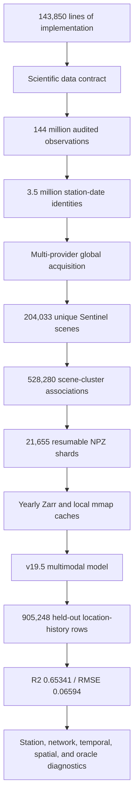

The figures in this profile are not being presented as decorative scale
statistics. Each one corresponds to a different engineering problem: the
observation count required streaming and audit; the sample count required stable
identity and low-memory joins; the scene and shard counts required clustering
and resumability; and the held-out prediction count required streamed
evaluation rather than an in-memory dataframe.

> **Technical feat — turning remote sensing into a reproducible experiment.**
> The system did not simply download images. It selected temporally valid
> acquisitions, shared remote work across overlapping station requests, retained
> exact-versus-overview semantics, survived network interruption, transferred
> state between environments, validated checksums, and only then exposed arrays
> to model training.

> **Technical feat — optimisation as an enabling result.** The estimated
> unoptimised experiment would require approximately 700 GB of data, 60 days of
> high-end GPU compute, and impractical network transfer. The project therefore
> solved a systems problem before it solved a regression problem: it reduced
> redundant work while retaining the provenance needed to explain what was
> removed, approximated, cached, or reused.

> **Technical feat — scientific caution at scale.** The report does not hide
> calibration dependence, depth pooling, acquisition mismatch, location
> memorisation risk, or test-selection limitations. Identifying those boundaries
> is part of the achievement because global predictive systems can be made to
> look impressive by silently discarding precisely the difficult cases.

---

## 2. System at a glance

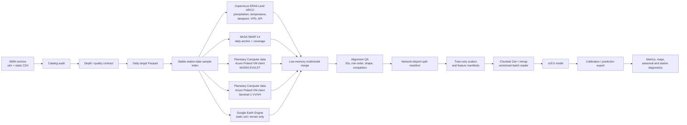

---

## 3. Repository source map

The reported implementation footprint is **143,850 lines of code**. That number
is significant because the project is not one notebook with a model definition:
it includes acquisition clients, archive parsers, scientific contracts,
distributed-work recovery, storage conversion, alignment audits, cache builders,
training infrastructure, and a large diagnostic/evaluation surface. The source
map below shows how that implementation is divided into independently auditable
scientific and computing responsibilities.

| Engineering subsystem | Technical responsibility | Why it was necessary |
|---|---|---|
| Scientific contracts | Units, depths, UTC semantics, channels, target guards | Prevents incompatible measurements from becoming one apparently homogeneous label |
| Archive and catalog systems | Header parsing, quality audit, depth classification, daily reduction | Makes international station data computationally joinable without losing provenance |
| Cloud acquisition | STAC search, SAS signing, COG windows, nearest-valid selection | Converts remote archives into bounded, repeatable reads |
| Distributed recovery | Cluster state, scene shards, SQLite snapshots, manifests, checksums | Makes multi-day global extraction resumable rather than all-or-nothing |
| Array and storage systems | Parquet, Zarr, NPZ, SQLite, NumPy mmap, FP16 caches | Uses the appropriate representation for tables, tensors, mutable state, transfer, and training |
| Alignment and validation | Stable IDs, producer row indexes, shape/dtype/finite/completion checks | Prevents silent permutation and stale-cache failures |
| ML systems | Spatial encoders, TCN, masks, gates, fusion, calibration, AMP, EMA | Represents spatial, temporal, static, missingness, and anchor information together |
| Evaluation systems | Full-count metrics, paired comparisons, maps, event tables, oracle diagnostics | Separates predictive performance from sampling, calibration, and error-tail effects |

| Layer | Main artifact | Responsibility |
|---|---|---|
| Contract | [`global_data_contract.py`](./global_data_contract.py) | Canonical channels, units, depths, patch size, quality policy |
| ISMN catalog | [`build_global_ismn_catalog.py`](./build_global_ismn_catalog.py) | Header parsing, depth classification, quality audit |
| ISMN daily labels | [`build_global_ismn_dataset.py`](./build_global_ismn_dataset.py) | Good-quality filtering and UTC daily aggregation |
| Label dates | [`build_global_label_dates.py`](./build_global_label_dates.py) | Station/cell/date export keys for raster extraction |
| ERA5 backend | [`01_global_ismn_era5_backend.ipynb`](./01_global_ismn_era5_backend.ipynb) | Stable samples and ERA5-derived temporal features |
| Static extraction | [`GEE_STATIC_GLOBAL.ipynb`](./GEE_STATIC_GLOBAL.ipynb) | GEE-only soil/terrain static layers |
| ERA5 backend | [`01_global_ismn_era5_backend.ipynb`](./01_global_ismn_era5_backend.ipynb) | Copernicus ERA5-Land ARCO temporal backend |
| Sentinel-1 production | [`BUILD_SENTINEL_RTC_GLOBAL_overview_production_v9_vv_vh_only.ipynb`](./BUILD_SENTINEL_RTC_GLOBAL_overview_production_v9_vv_vh_only.ipynb) | Planetary Computer STAC/COG nearest-valid radar patches |
| MODIS production | [`MODIS_GLOBAL_EVI.ipynb`](./MODIS_GLOBAL_EVI.ipynb) | Planetary Computer STAC/COG EVI/LST extraction |
| Azure resume | [`CREATE_SENTINEL_AZURE_RESUME_BUNDLE.ipynb`](./CREATE_SENTINEL_AZURE_RESUME_BUNDLE.ipynb) | Transfer, checksum, shard resume, cloud recovery |
| SMAP extraction | [`SMAP_extract.ipynb`](./SMAP_extract.ipynb) | Daily microwave anchor and observation-count metadata |
| Dataset merge | [`merge_global_dataset_low_memory_fixed.ipynb`](./merge_global_dataset_low_memory_fixed.ipynb) | Disk-backed joins while retaining raster stores |
| Alignment QA | [`verify_global_raster_alignment.ipynb`](./verify_global_raster_alignment.ipynb) | Sidecar IDs, row counts, metadata, sampled reads |
| Row-order QA | [`verify_global_raster_row_order.ipynb`](./verify_global_raster_row_order.ipynb) | MODIS/Sentinel ordering and completion checks |
| Split construction | [`build_global_splits.py`](./build_global_splits.py) | Deterministic network-disjoint cohorts |
| Tensor packing | [`build_global_tensors.py`](./build_global_tensors.py) | Shape, finite-value, sequence, and manifest validation |
| Local raster cache | [`prepare_local_normalized_raster_cache.py`](./prepare_local_normalized_raster_cache.py) | Train-only normalisation, masks, FP16 memory maps |
| Training | [`run_global_soil_model_v19_5_persistent_cache_compile_default_reupload.ipynb`](./run_global_soil_model_v19_5_persistent_cache_compile_default_reupload.ipynb) | v19 model, tuning, training, checkpoints |
| Error analysis | [`v19_5_full_error_analysis_visualization_v2.ipynb`](./v19_5_full_error_analysis_visualization_v2.ipynb) | Integrity, calibration, spatial, temporal, station diagnostics |

---

## 4. Full production pipeline

### 4.1 Expansive pipeline diagram

```mermaid
flowchart TB
    subgraph S0["0. Source systems"]
        ISMN["ISMN archive<br/>station .stm files"]
        STATIC["ISMN static-variable CSVs<br/>texture / climate metadata"]
        ERA["Copernicus ERA5-Land ARCO<br/>daily meteorology"]
        SMAP["NASA SMAP L4<br/>3-hourly / daily microwave SM"]
        MODIS["Microsoft Planetary Computer<br/>MODIS EVI/LST"]
        S1["Microsoft Planetary Computer<br/>Sentinel-1 RTC VV/VH"]
        SOIL["Google Earth Engine<br/>SoilGrids / soil texture"]
        DEM["Google Earth Engine<br/>NASADEM / terrain"]
    end

    subgraph S1A["1. Contract and ground-truth audit"]
        CONTRACT["Versioned contract<br/>UTC, units, depth, range, channels"]
        HEADER["Parse station headers<br/>network, station, lat/lon,<br/>elevation, sensor, depth"]
        DEPTH["Classify depths<br/>near_surface 0-5 cm<br/>fallback_deeper 5-10 cm<br/>exclude outside 0-10 cm"]
        QUALITY["Scan observations<br/>retain quality flag G<br/>count malformed/non-good rows"]
        DAILY["Aggregate valid observations<br/>by station-file and UTC day"]
        CATALOG["Catalog CSV + summary JSON"]
        LABELS["Cell/date label manifest"]
    end

    ISMN --> HEADER
    STATIC --> HEADER
    CONTRACT --> DEPTH
    HEADER --> DEPTH --> QUALITY --> DAILY
    HEADER --> CATALOG
    DAILY --> LABELS

    subgraph S2A["2. Canonical sample index and temporal features"]
        INDEX["Stable sample_id<br/>station_id + sample_date + provenance"]
        ERAJOIN["ERA5 join by station/date or cell/date"]
        VPD["VPD derivation<br/>temperature + dewpoint"]
        API["Antecedent precipitation index"]
        TEMP["Temporal feature table<br/>precip, t2m, d2m, VPD, API"]
    end

    DAILY --> INDEX
    LABELS --> INDEX
    ERA --> ERAJOIN --> VPD --> TEMP
    ERAJOIN --> API --> TEMP
    INDEX --> ERAJOIN

    subgraph S3A["3. Remote-sensing and static extraction"]
        CELL["Approximate global 1 km cell key"]
        COLLISION["Deterministic same-cell station collapse<br/>retain collision mapping"]
        TILES["Adaptive spatial tiles<br/>bounded station count"]
        WINDOWS["Yearly / bounded time windows"]
        STAC["Planetary Computer STAC<br/>signed COG asset URLs"]
        CLUSTER["Storage-aware scene clustering<br/>stations sharing scenes/windows"]
        SQLITE["SQLite scene inventory<br/>cluster searches + associations"]
        SHARDS["Resumable per-scene NPZ shards<br/>atomic completion markers"]
        S1PATCH["Sentinel-1 nearest-valid<br/>13 x 13 yearly Zarr"]
        MODISPATCH["MODIS EVI/LST<br/>27 x 27 EVI, 13 x 13 LST"]
        SMAPPATCH["SMAP daily join<br/>value, count, conflict flags"]
        STATICPATCH["Static texture / terrain<br/>cell-level features"]
    end

    INDEX --> CELL --> COLLISION --> TILES --> WINDOWS --> STAC
    S1 --> STAC --> CLUSTER --> SQLITE --> SHARDS --> S1PATCH
    MODIS --> STAC --> MODISPATCH
    SMAP --> SMAPPATCH
    SOIL --> STATICPATCH
    DEM --> STATICPATCH
    INDEX --> SMAPPATCH

    subgraph S4A["4. Merge, alignment, and integrity"]
        JOIN["Low-memory DuckDB / Parquet merge<br/>sample_id and row-index joins"]
        ROWS["Explicit MODIS and Sentinel row indices"]
        ALIGN["Alignment checks<br/>row counts, IDs, shapes, sample reads"]
        ORDER["Producer sort contract<br/>date then sample_id"]
        FINITE["Finite/range/missingness checks"]
        MODELREADY["Model-ready index<br/>daily targets + raw observations"]
    end

    INDEX --> JOIN
    TEMP --> JOIN
    SMAPPATCH --> JOIN
    MODISPATCH --> JOIN
    S1PATCH --> JOIN
    STATICPATCH --> JOIN
    JOIN --> ROWS --> ALIGN
    ORDER --> ALIGN
    JOIN --> FINITE --> MODELREADY
    ALIGN --> MODELREADY

    subgraph S5A["5. Cohorts and representation"]
        COHORT["Eligible station cohort<br/>depth + quality + minimum rows"]
        SPLIT["Deterministic network-disjoint<br/>train / validation / test"]
        TARGETS["Daily target aggregation<br/>source observations preserved"]
        MANIFEST["Feature manifests<br/>history, anchor, static, targets"]
        SCALER["Train-only scalers<br/>signature and hashes"]
        CACHE["Normalised FP16 raster cache<br/>value + validity masks"]
        TENSORS["Packed tensors / vectorised reader<br/>spatial, temporal, static, target, anchor"]
    end

    MODELREADY --> COHORT --> SPLIT
    MODELREADY --> TARGETS --> MANIFEST
    SPLIT --> MANIFEST
    MANIFEST --> SCALER --> CACHE --> TENSORS
    MANIFEST --> TENSORS

    subgraph S6A["6. v19.5 training and inference"]
        SPATIAL["Multi-scale spatial encoder<br/>local + dilated depthwise paths"]
        POOL["Mean + max + learned attention pooling"]
        TEMPENC["TCN temporal encoder<br/>history attention + last/history gate"]
        STATICENC["Static MLP / feature projection"]
        LOC["Optional location embedding"]
        FUSION["Gated multimodal fusion"]
        HEAD["Prediction head<br/>direct or residual target mode"]
        CAL["Quadratic anchor/residual calibration"]
        CKPT["EMA/best checkpoint<br/>hash recorded"]
    end

    TENSORS --> EVIENC["EVI stem<br/>value + mask"] --> POOL
    TENSORS --> LSTENC["LST stem<br/>value + mask"] --> POOL
    TENSORS --> S1ENC["S1 stem<br/>VV, VH, ratio<br/>value + mask"] --> POOL
    POOL --> FUSION
    TENSORS --> TEMPENC --> FUSION
    TENSORS --> STATICENC --> FUSION
    TENSORS --> LOC --> FUSION
    FUSION --> HEAD --> CAL --> CKPT

    subgraph S7A["7. Evaluation and diagnostics"]
        PRED["Final-checkpoint train/test predictions"]
        METRIC["RMSE, MAE, R2, robust metrics"]
        PAIRED["Paired station/network comparison"]
        TIME["Annual, monthly, seasonal, moisture-bin diagnostics"]
        MAPS["Global and regional error maps"]
        INTEGRITY["Target alignment, row counts,<br/>calibration and provenance checks"]
    end

    CKPT --> PRED --> METRIC
    PRED --> PAIRED
    PRED --> TIME
    PRED --> MAPS
    PRED --> INTEGRITY
```

### 4.2 Compact segmented module diagram

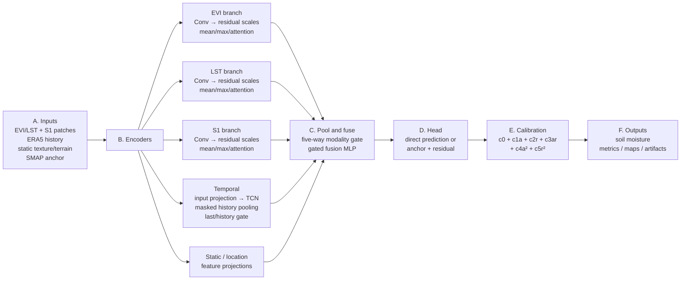

### 4.2.1 Expanded execution DAG

The preceding diagram shows the logical stages. The following diagram expands
the operations that are easy to hide inside a single box. It is intentionally
large: the project is a data system, a distributed raster-extraction system,
and a learning system at the same time.

```mermaid
flowchart TB
    subgraph RAW["A. Physical data sources and access protocols"]
        A1["ISMN .stm station files"]
        A2["ISMN static-variable CSVs"]
        A3["Copernicus ERA5-Land ARCO Zarr"]
        A4["NASA SMAP L4 files / exports"]
        A5["Planetary Computer STAC API"]
        A6["Planetary Computer SAS token service"]
        A7["Sentinel-1 RTC COG assets"]
        A8["MODIS EVI/LST COG or tile assets"]
        A9["Google Earth Engine static collections"]
        A10["Azure Poland VM<br/>high-throughput client"]
    end

    subgraph GT["B. ISMN ground-truth construction"]
        B1["Enumerate archive members"]
        B2["Parse station header"]
        B3["Canonical station_id"]
        B4["Read depth_from/depth_to"]
        B5["Depth classifier"]
        B6["Record exclusion reason"]
        B7["Scan observation rows"]
        B8["Parse date/value/quality"]
        B9["Retain flag G"]
        B10["Reject malformed/non-finite rows"]
        B11["UTC calendar-day grouping"]
        B12["Daily mean and count"]
        B13["Retain sensor/depth/source provenance"]
        B14["Catalog CSV"]
        B15["Catalog summary JSON"]
        B16["Daily Zstandard Parquet"]
    end
    A1 --> B1 --> B2 --> B3
    B2 --> B4 --> B5 --> B6
    B2 --> B7 --> B8 --> B9 --> B11 --> B12 --> B16
    B8 --> B10
    B12 --> B13 --> B16
    B2 --> B14 --> B15
    A2 --> B2

    subgraph IDX["C. Identity, grid, and temporal backbone"]
        C1["Stable station/date candidate"]
        C2["sample_id"]
        C3["Station coordinates"]
        C4["Approximate 1 km EASE-grid cell"]
        C5["ERA5 0.1-degree point index"]
        C6["ERA5 daily temperature"]
        C7["ERA5 daily dewpoint"]
        C8["ERA5 daily precipitation"]
        C9["VPD derivation"]
        C10["API recurrence / antecedent window"]
        C11["Temporal feature table"]
        C12["SMAP station/cell/date key"]
        C13["SMAP duplicate collapse"]
        C14["SMAP conflict audit"]
        C15["SMAP value + observation count"]
        C16["Calendar sin/cos"]
    end
    B16 --> C1 --> C2 --> C3 --> C4
    C1 --> C5 --> C6 --> C7 --> C8
    C6 --> C9
    C8 --> C10
    C9 --> C11
    C10 --> C11
    C2 --> C12 --> C13 --> C14 --> C15
    C2 --> C16
    A3 --> C5
    A4 --> C12

    subgraph PC["D. Planetary Computer / Azure dynamic extraction"]
        D1["Station-cell collision map"]
        D2["Adaptive spatial clustering"]
        D3["Cluster temporal overlap"]
        D4["STAC query cache"]
        D5["STAC scene inventory"]
        D6["Signed asset URLs"]
        D7["COG tile geometry"]
        D8["Nearest-valid scene selection"]
        D9["Earlier-date tie break"]
        D10["18-day tolerance"]
        D11["Overview read benchmark"]
        D12["512 x 512 overview tile"]
        D13["Optional exact native read"]
        D14["Window transform / reprojection"]
        D15["VV read"]
        D16["VH read"]
        D17["Ratio / derived radar channels"]
        D18["Validity masks"]
        D19["Per-scene NPZ shard"]
        D20["Atomic completion marker"]
        D21["SQLite scene_clusters"]
        D22["SQLite cluster_searches"]
        D23["Transfer manifest"]
        D24["Yearly Sentinel Zarr"]
        D25["Yearly MODIS Zarr"]
    end
    C4 --> D1 --> D2 --> D3 --> D4 --> D5 --> D6 --> D7
    D6 --> D8 --> D9 --> D10
    D7 --> D11 --> D12 --> D14
    D11 --> D13 --> D14
    D14 --> D15 --> D17 --> D18 --> D19 --> D20 --> D24
    D14 --> D16 --> D17
    D2 --> D21
    D3 --> D22
    D20 --> D23
    D6 --> D25
    A5 --> D4
    A6 --> D6
    A7 --> D15
    A8 --> D25
    A10 --> D2

    subgraph GEE["E. Static-only GEE extraction"]
        E1["Global station/static table"]
        E2["SoilGrids texture image"]
        E3["NASADEM image"]
        E4["Elevation band"]
        E5["Slope derivation"]
        E6["Aspect derivation"]
        E7["Station/cell reduction"]
        E8["Static soil CSV"]
        E9["Static terrain CSV"]
        E10["Static join validation"]
    end
    A9 --> E2 --> E1
    A9 --> E3 --> E4 --> E5 --> E6
    E1 --> E7 --> E8
    E6 --> E9
    E8 --> E10
    E9 --> E10

    subgraph JOIN["F. Merge and alignment"]
        F1["Canonical sample table"]
        F2["ERA5 join"]
        F3["SMAP left join"]
        F4["Static join"]
        F5["MODIS row index"]
        F6["Sentinel row index"]
        F7["Year partition"]
        F8["Disk-backed DuckDB join"]
        F9["Daily target aggregation"]
        F10["Raw target observations retained"]
        F11["MODIS row-count check"]
        F12["Sentinel row-count check"]
        F13["Sidecar sample-ID check"]
        F14["Shape/chunk/dtype check"]
        F15["Completion-flag check"]
        F16["Sampled pixel read check"]
        F17["Producer sort reconstruction"]
        F18["Semantic alignment decision"]
        F19["Model-ready sample index"]
        F20["Model-ready daily targets"]
    end
    C2 --> F1 --> F2 --> F3 --> F4 --> F8
    C11 --> F2
    C15 --> F3
    E10 --> F4
    D24 --> F5 --> F8
    D25 --> F6 --> F8
    F1 --> F7 --> F8
    F8 --> F9 --> F10 --> F20
    F8 --> F11 --> F12 --> F13 --> F14 --> F15 --> F16
    F17 --> F18
    F16 --> F18 --> F19

    subgraph DATASET["G. Cohort, manifest, and tensor construction"]
        G1["Depth eligibility filter"]
        G2["Minimum good-row filter"]
        G3["Network inventory"]
        G4["Stable hash ordering"]
        G5["Train network assignment"]
        G6["Validation network assignment"]
        G7["Test network assignment"]
        G8["Target mode selection"]
        G9["History window builder"]
        G10["Padding mask builder"]
        G11["Anchor feature builder"]
        G12["Static feature builder"]
        G13["Location feature builder"]
        G14["Feature manifest"]
        G15["Train-only scalar scalers"]
        G16["Train-only raster scalers"]
        G17["Scaler fingerprint"]
        G18["Raster decode"]
        G19["Physical range filter"]
        G20["Value + mask construction"]
        G21["FP16 normalisation"]
        G22["Memory-map writer"]
        G23["Shape validator"]
        G24["Finite-value validator"]
        G25["Sequence-length validator"]
        G26["Packed train/val/test arrays"]
        G27["Metadata sidecars"]
    end
    F19 --> G1 --> G2 --> G3 --> G4 --> G5 --> G6 --> G7
    F20 --> G8 --> G9 --> G10 --> G14
    F3 --> G11 --> G14
    F4 --> G12 --> G14
    G7 --> G14
    G14 --> G15 --> G17
    G14 --> G16 --> G17
    G16 --> G18 --> G19 --> G20 --> G21 --> G22
    G14 --> G23 --> G24 --> G25 --> G26 --> G27

    subgraph MODEL["H. v19.5 forward pass"]
        H1["EVI values + masks"]
        H2["LST values + masks"]
        H3["S1 values + masks"]
        H4["EVI stem"]
        H5["LST stem"]
        H6["S1 stem"]
        H7["Local depthwise path"]
        H8["Dilated depthwise path"]
        H9["1x1 channel mixing"]
        H10["Residual skip addition"]
        H11["Mean pooling"]
        H12["Max pooling"]
        H13["Spatial attention pooling"]
        H14["Temporal input projection"]
        H15["Positional representation"]
        H16["TCN dilation 1"]
        H17["TCN dilation 2"]
        H18["Masked history scoring"]
        H19["Last-valid extraction"]
        H20["Last/history sigmoid gate"]
        H21["Static MLP"]
        H22["Location projection"]
        H23["Five-way modality gate"]
        H24["Gated fusion width 192"]
        H25["Fusion MLP 192 → 96 → 1"]
        H26["Direct/residual output"]
        H27["Anchor/calibration input"]
        H28["Quadratic calibration"]
        H29["Prediction"]
    end
    G26 --> H1 --> H4 --> H7 --> H9 --> H10 --> H11 --> H23
    G26 --> H2 --> H5 --> H8 --> H9
    G26 --> H3 --> H6 --> H8
    H10 --> H12 --> H23
    H10 --> H13 --> H23
    G26 --> H14 --> H15 --> H16 --> H17 --> H18 --> H19 --> H20 --> H23
    G26 --> H21 --> H23
    G26 --> H22 --> H24
    H23 --> H24 --> H25 --> H26 --> H28 --> H29
    G26 --> H27 --> H28

    subgraph EVAL["I. Evaluation, oracle trimming, and release"]
        I1["Final checkpoint restore"]
        I2["Train inference"]
        I3["Test inference"]
        I4["Manifest-target alignment"]
        I5["Raw metrics"]
        I6["Calibrated metrics"]
        I7["Robust metrics"]
        I8["Anchor comparison"]
        I9["Paired station comparison"]
        I10["Network metrics"]
        I11["Annual metrics"]
        I12["Monthly metrics"]
        I13["Moisture-bin metrics"]
        I14["Spatial grid metrics"]
        I15["High-error ranking"]
        I16["Oracle trimming curves"]
        I17["Station error maps"]
        I18["Residual plots"]
        I19["Checkpoint SHA256"]
        I20["Analysis manifest"]
        I21["Prediction Parquet"]
    end
    H29 --> I1 --> I2 --> I3 --> I4
    I3 --> I5 --> I6 --> I7
    I6 --> I8
    I6 --> I9 --> I10
    I6 --> I11 --> I12 --> I13 --> I14
    I6 --> I15 --> I16
    I6 --> I17
    I6 --> I18
    I1 --> I19
    I4 --> I20
    I3 --> I21
```

### 4.3 Sub-box implementation map

The diagram is intentionally decomposed below. Each item corresponds to a
visible family of operations in the diagrams; none should be interpreted as a
single magical “preprocessing step.”

#### 4.3.1 Source systems

The raw inputs have different access models. ISMN is an archive of station
records; ERA5-Land is a gridded Copernicus data service; SMAP is a NASA
microwave product; MODIS and Sentinel-1 are cloud-hosted Planetary Computer
assets accessed through STAC and COG protocols; static layers are obtained from
GEE. This matters because the limiting resource changes by source: parsing,
grid indexing, network transfer, cloud authentication, or local storage.

#### 4.3.2 Contract and ground-truth audit

The contract defines units, quality, depth, time zone, channels, ranges, and
patch size. The catalog parser then turns free-form station headers into typed
records. The observation scanner counts every row, separates good from
non-good quality, rejects malformed values, and records the date range. Daily
aggregation makes the label time scale compatible with the environmental
products while retaining counts and provenance.

#### 4.3.3 Identity, grid, and temporal backbone

Stable IDs are the join keys of the project. A station/date identity prevents
the same physical sample from being silently duplicated or joined to the wrong
remote-sensing row. The 1 km cell key supports station collision handling and
the ERA5 point index avoids repeatedly solving the same nearest-grid problem.
VPD and API are derived deterministic transformations, not learned features.

#### 4.3.4 Planetary Computer and Azure extraction

STAC is the catalogue query layer; SAS signing makes cloud assets readable;
COG windows avoid downloading complete global scenes; clusters reuse scene
searches and reads; NPZ shards create restart points; SQLite stores the
inventory and associations. The paid Azure Poland VM is the compute client
that executes this workload at higher throughput; Planetary Computer remains
the authoritative data host.

#### 4.3.5 Static GEE extraction

The static path is separate because texture and terrain do not require daily
scene selection. GEE produces the static soil and terrain tables, which are
joined by station/cell identity and validated before the dynamic data are
merged.

#### 4.3.6 Merge and alignment

The merge is an identity problem, not only a dataframe operation. Scalar tables
are joined by keys, raster stores are referenced by explicit row indices, and
the producer sort contract is checked. Equal row counts alone are insufficient:
two arrays can have identical dimensions while row 10,000 refers to a different
station-date in each array.

#### 4.3.7 Cohorts, manifests, and tensors

Eligibility removes incompatible depth and insufficient-quality records. Split
assignment happens before fitting scalers. Manifests describe exactly which
raster row, history row, static vector, target, and anchor belong together.
Raster decoding then creates value/mask channels and memory maps. Validators
reject shape, sequence, and finite-value violations before training.

#### 4.3.8 Forward pass and release

The forward pass is the learned part of the system. The model transforms each
modality independently, combines them adaptively, produces a direct or residual
estimate, and applies the recorded calibration. Evaluation then treats the
checkpoint as a scientific artifact: it restores the exact weights, checks
target alignment, computes metrics, writes predictions, and records hashes and
analysis configuration.

### 4.3.9 Sub-box diagrams

The following diagrams expand each major non-model sub-box. They show the
operational sequence inside the larger execution DAG.

#### A. Source systems and access paths

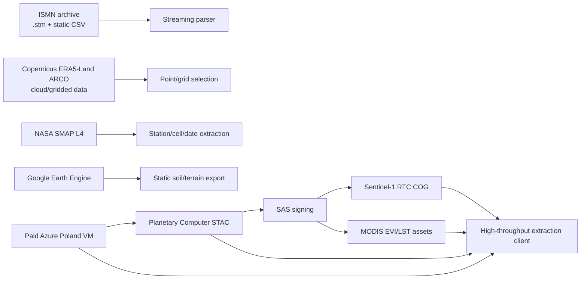

#### B. ISMN ground-truth construction

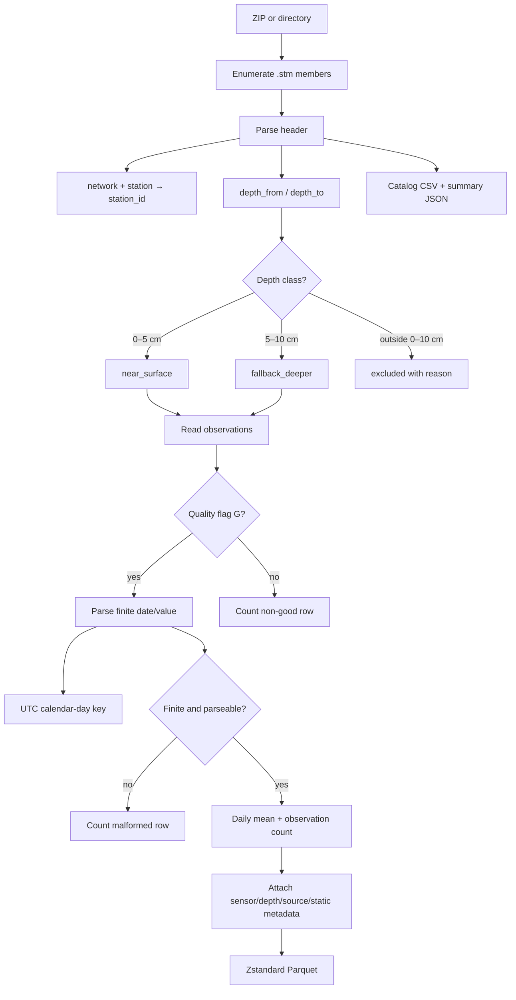

#### C. Canonical identity and temporal features

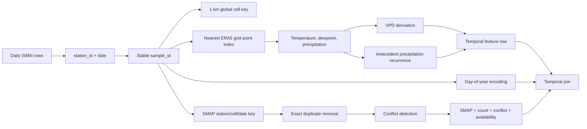

#### D. Planetary Computer and Azure extraction

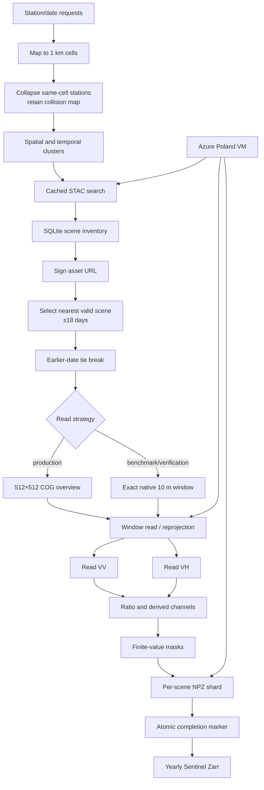

#### E. Static GEE extraction

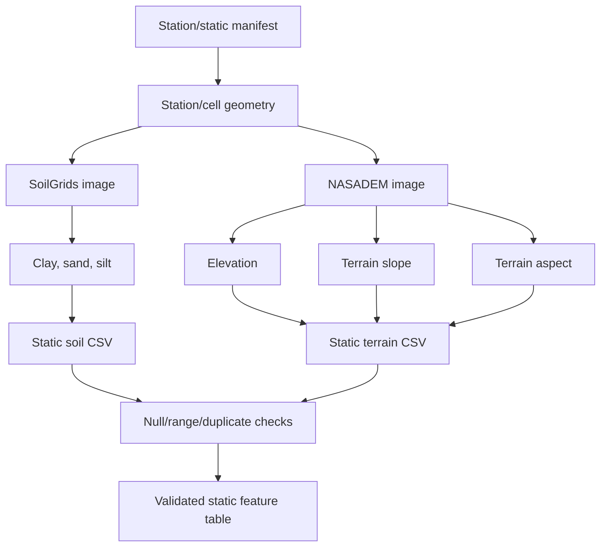

#### F. Merge and alignment QA

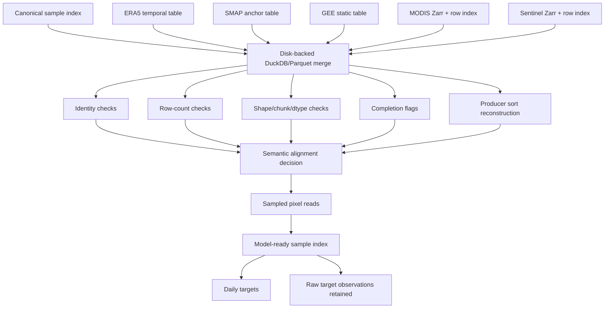

#### G. Cohorts, manifests, and tensors

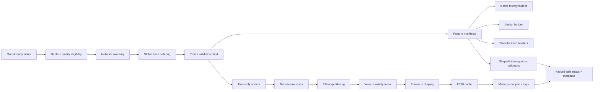

#### H. Evaluation and release

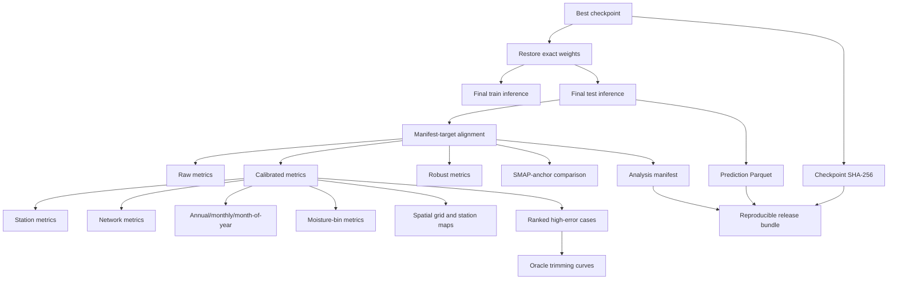

### 4.4 Detailed v19.5 model graph

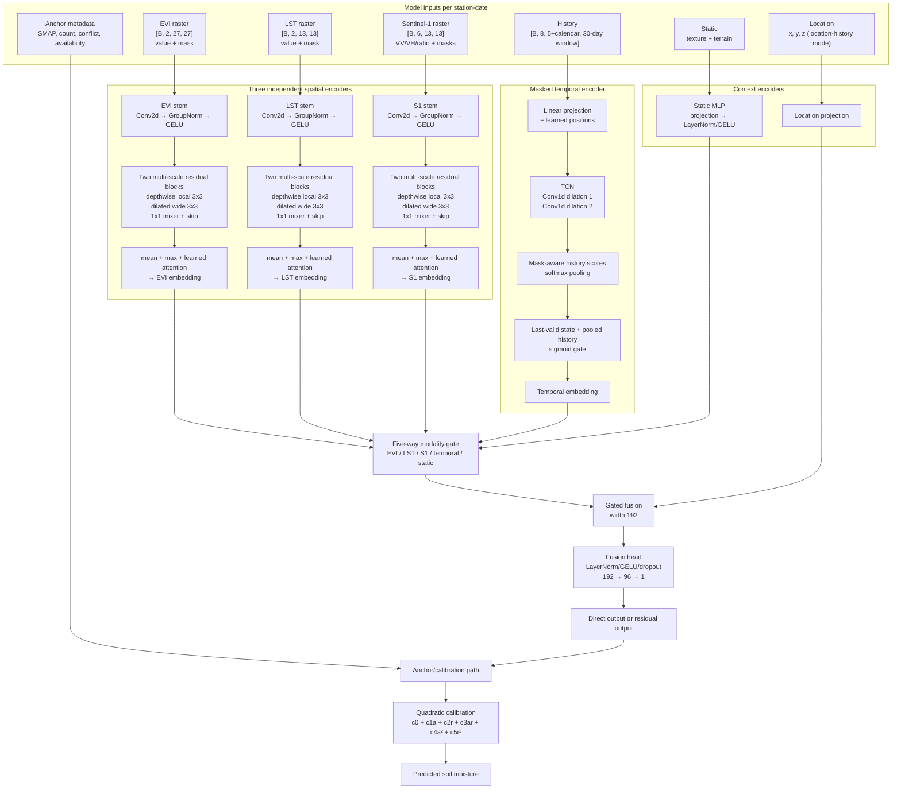

---

## 5. Data contract and data products

The contract is implemented in [`global_data_contract.py`](./global_data_contract.py).
It prevents silent mixing of incompatible labels and makes downstream tensors
self-describing.

| Contract item | Value |
|---|---|
| Contract code version | `global-v2` |
| Spatial footprint | 13 x 13 pixels |
| Nominal grid | 1,000 m |
| Time standard | UTC |
| Target unit | `m3/m3` |
| Primary depth | 0.00–0.05 m |
| Explicit fallback | 0.05–0.10 m |
| Excluded depth | Outside 0–10 cm |
| Accepted quality flag | `G` |
| Target range guard | 0.0–0.6 `m3/m3` |
| Spatial channels | 10 |
| Static channels | 6 |

The model-ready feature schema adds task-specific fields:

- **Temporal:** precipitation, 2 m temperature, dewpoint, VPD, API.
- **Static:** clay, sand, silt, terrain elevation, slope, aspect encoded as sine/cosine.
- **Anchor:** SMAP, observation count, cell-conflict count, availability flag.
- **Location-history mode:** 3-D location representation and eight history steps
  within a maximum 30-day window.
- **Rasters:** EVI/LST and Sentinel-1 arrays with explicit validity masks.

### Important version distinction

The checked-in `global_station_catalog_summary.json` was generated with a
`global-v1` summary contract containing an additional incidence-angle channel,
while the current Python contract is `global-v2` with the canonical 10 spatial
channels. This is not treated as an interchangeable schema. Any regenerated
catalog or tensor bundle must record the contract used at build time and must be
validated against the training manifest before use.

---

## 6. Ground-truth construction

### 6.1 Station catalog

[`build_global_ismn_catalog.py`](./build_global_ismn_catalog.py) parses station
headers and records:

- network and station identity;
- latitude, longitude, and elevation;
- sensor and layer depths;
- depth class and exclusion reason;
- source-file path;
- observation counts, good-quality counts, malformed counts, and date range.

The catalog is intentionally cheap to build in header-only mode, with an optional
full observation scan for cohort selection.

### 6.2 Quality and depth policy

Only observations carrying the documented good-quality flag `G` contribute to
daily labels. Depths are classified before aggregation:

```text
0.00 m <= depth_from and depth_to <= 0.05 m  -> near_surface
0.05 m <= depth_from and depth_to <= 0.10 m  -> fallback_deeper
otherwise                                      -> excluded
```

This avoids the scientifically dangerous shortcut of treating all ISMN layers as
surface soil moisture.

### 6.3 Daily Parquet

[`build_global_ismn_dataset.py`](./build_global_ismn_dataset.py) streams either a
directory or ZIP archive, averages valid observations within each station-file
and UTC calendar day, and writes Zstandard-compressed Parquet. The output retains
depth, sensor, station, static texture, climate metadata, counts, and source
provenance instead of reducing labels to an unexplained numeric column.

Repository profile:

| Quantity | Value |
|---|---:|
| Daily Parquet rows | 5,045,849 |
| Unique stations | 2,210 |
| Networks | 61 |
| Unique station-date samples | 3,514,643 |
| Date range | 2015-04-01 to 2026-10-03 |
| Latitude extent | -45.26482 to 71.32980 |
| Longitude extent | -165.12042 to 175.91821 |
| Observation rows audited | 144,466,562 |
| Good-quality rows | 103,504,765 |
| Non-good rows | 40,961,797 |
| Malformed rows | 0 |

The source archive is heterogeneous: 4,340 station files span 61 networks,
with 4,002 compatible-depth files. The catalog contains 1,578 near-surface files,
2,424 fallback-deeper files, and 338 exclusions.

> **Technical achievement — converting an uncontrolled international archive into
> a scientific target.** The system parsed station headers, classified layer
> depth, audited quality flags, handled malformed records, aggregated by UTC
> day, retained observation counts, and preserved source-file provenance. This
> is the data equivalent of calibrating and documenting every detector channel
> before combining measurements.

---

## 7. Remote-sensing and environmental feature engineering

### 7.1 ERA5-Land

The ERA5 backend creates station/date-aligned weather features at the global
1 km contract. It derives:

- daily precipitation;
- daily 2 m temperature;
- daily dewpoint temperature;
- vapour-pressure deficit (VPD);
- antecedent precipitation index (API).

The weather stream is kept as a temporal table so it can be joined and audited
without duplicating raster data.

### 7.2 SMAP anchor

SMAP extraction aggregates valid microwave observations to daily station values
and records `SMAP_n_obs`. The conflict-safe rebuild script preserves every
canonical sample, validates one-to-one station/date joins, and leaves unmatched
SMAP values explicitly null rather than converting missingness to zero.

### 7.3 MODIS — Planetary Computer, processed from Azure Poland

The MODIS path supplies vegetation and thermal context through the Microsoft
Planetary Computer STAC catalogue and cloud-hosted Cloud-Optimized GeoTIFF
(COG) assets. The extraction code searches the STAC index, signs asset URLs,
opens only the spatial windows needed for each station cluster, and writes
year-partitioned Zarr arrays. This is not a GEE export path.

The production assets retain their native patch footprints:

- EVI/NDVI patch: 27 x 27 in the model-ready raster schema;
- LST patch: 13 x 13;
- scale conversions are recorded in the extraction/cache code;
- temporal windows are product-specific rather than forced into a false
  single-resolution representation.

### 7.4 Sentinel-1 — Planetary Computer, processed from Azure Poland

Sentinel-1 RTC data are retrieved through Planetary Computer's STAC API and
signed COG assets. For every station-date, the pipeline searches for the
nearest valid acquisition within an 18-day tolerance, allowing observations
before or after the target date and breaking ties deterministically in favour
of the earlier acquisition.

The production read path uses a 512 x 512 COG overview tile (5.12 km at the
source scale) to approximate the 10 m to 1 km aggregation. This was selected
after benchmarking because it dramatically reduces network reads and
decompression work. A separate exact native-pixel path remains available, and
the output namespace records which strategy produced the values so approximate
and exact arrays cannot be mixed.

> **Technical achievement — making a planetary archive computationally usable.**
> The system combined STAC discovery, signed COG access, nearest-valid temporal
> selection, overview benchmarking, exact-read fallback, scene clustering, and
> Azure-local processing. The difficult part was not writing a raster reader; it
> was designing a reader whose remote request pattern, failure recovery, and
> numerical semantics remained auditable at global scale.

### 7.5 Google Earth Engine — static layers only

GEE is used for static soil and terrain export: clay, sand, silt, elevation,
slope, and aspect. It is not the production source for dynamic MODIS,
Sentinel-1, ERA5, or SMAP. Several earlier GEE notebooks are regional
prototypes or failed/abandoned experiments; the authoritative static workflow
is [`GEE_STATIC_GLOBAL.ipynb`](./GEE_STATIC_GLOBAL.ipynb).

### 7.6 Static soil and terrain

Static features include clay, sand, silt, elevation, slope, and aspect. Aspect is
represented as sine/cosine during training to avoid a discontinuity between 359
degrees and 0 degrees.

---

## 8. Global export, merge, and alignment engineering

### 8.1 Bounded Planetary Computer extraction

The Planetary Computer notebooks make the global problem operationally tractable:

1. Convert station coordinates into deterministic approximate 1 km global cells.
2. Collapse stations sharing a cell using a stable station-ID rule.
3. Retain the collision map for provenance.
4. Partition stations into adaptive spatial tiles.
5. Partition time into bounded windows.
6. Search Planetary Computer STAC and sign COG assets.
7. Read only the required windows and write resumable scene shards.

This avoids an unbounded “one global task” failure mode and supports resume/retry
operations. [`gee_global_export.py`](./gee_global_export.py) is retained for
static/cell planning and is not evidence that dynamic production data came from
Earth Engine.

> **Technical achievement — separating authoritative data provenance from
> compute location.** Google Earth Engine supplies static layers only. Dynamic
> MODIS and Sentinel-1 data remain Planetary Computer products, while the paid
> Azure Poland VM is the high-throughput client. Keeping those roles distinct
> prevents an infrastructure optimisation from being misreported as a change
> in scientific data source.

### 8.2 The scene-clustering optimisation

The expensive operation is not merely downloading a raster. Each remote read has
fixed costs: STAC search latency, SAS signing, HTTP setup, COG tile fetch,
decompression, reprojection/window handling, and disk write. Reading one 13 x 13
patch independently for every station-date would repeat those costs millions of
times.

The Sentinel pipeline therefore clusters requests by shared storage locality:

1. Stations are mapped to the 1 km production grid.
2. Nearby stations and overlapping time windows are grouped into cluster IDs.
3. Each cluster performs one cached scene query rather than one query per sample.
4. A scene is opened once, and all relevant station windows are read from it.
5. Results are written as per-scene NPZ shards with completion state.
6. SQLite records scenes, cluster searches, and scene-cluster links.

The audited Azure transfer bundle reported 204,033 unique scenes, 819 cluster
searches, 528,280 scene-cluster association rows, 818 clusters with scene
associations, 21,655 NPZ shards, and no unlinked scenes. Clustering converts
repeated network and decompression work into reusable intermediate products.

### 8.3 Azure Poland compute acceleration and resume engineering

The Planetary Computer remained the authoritative host for the Sentinel-1 and
MODIS data. Azure was not used as the data provider or as a replacement archive.
After extensive network-read optimisation, a paid Azure virtual machine located
in Poland was provisioned as the high-throughput compute client. Its purpose was
to place the extraction workload on a better-connected, adequately provisioned
machine close to the cloud data path, reducing the time spent waiting on remote
STAC/COG reads, tile transfers, and decompression.

The Azure/WSL workflow also had to tolerate finite disk and memory, so resume
engineering was a substantial part of the project:

- the live SQLite database was backed up with SQLite's backup API before transfer;
- existing shards, cluster mappings, and inventory state were packaged separately
  from large legacy caches;
- archives were written with SHA-256 checksums;
- completed cluster searches were not reissued;
- scene shards could be moved off the VM and restored only when finalisation
  required them;
- low-memory profiles reduced scene workers and parallel polarisation reads;
- transfer manifests made cloud/local state explicit.

This is analogous to checkpointing a long numerical experiment: the data remains
in the authoritative Planetary Computer archive, while the Azure Poland VM
processes verified subproblems and can resume after interruption without
restarting the global calculation.

### 8.4 Low-memory joins

The merge notebook uses disk-backed processing and keeps raster arrays in yearly
Zarr stores. Scalar tables are joined by stable sample identities and explicit
row-index columns. This is preferable to expanding every raster patch into a
wide table.

### 8.5 Row-order problem and solution

A major integration risk was assuming that a sidecar table’s row order always
matched physical Zarr order. The current schema documents the producer sort
contract (year, sample date, sample ID) and records `modis_row_index` and
`s1_row_index`. Alignment notebooks verify:

- row counts;
- sample IDs and sidecars;
- Zarr dimensions and metadata;
- expected patch shapes;
- completion flags;
- sampled reads;
- MODIS and Sentinel ordering.

The model-ready schema explicitly warns that a historical writer-order change
requires rebuilding MODIS arrays and metadata rather than guessing an alignment.

### 8.6 What the computer is doing — a physics-facing explanation

The physical question is “what environmental state surrounds a station on a
given day?” The computer problem is that the answer is distributed across
terabytes of tiled files, irregular acquisition dates, different projections,
and slow network storage.

- A **COG** is a GeoTIFF organised internally into rectangular tiles and
  resolution overviews. The reader can request one small window without
  downloading the whole global image.
- A **Zarr store** is an array broken into chunks. It provides the same
  idea for the final model: the code reads the rows and channels needed by a
  batch instead of materialising every year in RAM.
- A **Parquet table** stores columns separately and compresses repeated values.
  The pipeline can therefore scan dates, coordinates, or targets without
  loading raster arrays.
- A **memory map** is a file-backed NumPy array. The operating system brings
  pages into memory when accessed and evicts them when pressure rises. This
  made a roughly 17 GiB raster mirror usable without requiring 17 GiB of
  resident RAM.
- A **validity mask** is a second channel saying whether a value is observed.
  Filling a missing pixel with a mean without this mask would tell the model
  that “missing” means “average physical value”; the mask prevents that
  ambiguity.
- **Chunk caching** is analogous to reusing a computed Green's-function block:
  the expensive source chunk is decompressed once, then many indexed samples
  reuse it. In this project, per-patch caching had almost no reuse, so the
  cache was moved to the native Zarr chunk level.

The engineering objective was therefore not simply to make files smaller. It was
to preserve the physical identity of each sample while minimising repeated
network transfers, decompression, reprojection, and memory allocation.

---

## 9. Cohorts, splits, and leakage controls

[`build_global_splits.py`](./build_global_splits.py) selects eligible station files
with compatible depth, no exclusion reason, and at least one good-quality row.
It assigns entire networks to exactly one split using a stable hash ordering.

Current manifest:

| Split | Rows | Networks |
|---|---:|---:|
| Train | 3,021 | 35 |
| Validation | 328 | 11 |
| Test | 599 | 11 |
| **Total** | **3,948** | **57** |

The manifest covers 1,954 stations. Keeping networks disjoint is a stronger
generalisation test than random row splitting because measurements from a single
network often share instrumentation, processing, climate, and site conventions.

The v19.5 training manifests also record a separate environment-only station-hash
split (seed 42) and a location-history temporal cutoff at 2022-12-31. Normalisers,
calibration coefficients, and checkpoint selection are fit from the training
workflow rather than from the held-out test predictions.

---

## 10. Model architecture

### 10.1 Final v19.5 configuration

| Parameter | Value |
|---|---|
| Architecture label | `multiscale_residual_spatial_temporal_attention_gated_fusion_v19` |
| Temporal backbone | TCN |
| Spatial width | 48 |
| Temporal hidden width | 64 |
| Fusion width | 192 |
| History | 8 steps, maximum 30 days |
| Optimiser | AdamW |
| Loss | MSE in final recorded configuration |
| Best epoch | 79, location-history; 13, environment-only |
| Effective batch size | 2,048 |
| EMA decay | 0.85 |
| Gradient clipping | 2.0 |

### 10.2 Spatial branches

The final model uses independent spatial stems for EVI, LST, and Sentinel-1.
This keeps modality-specific value/mask semantics separate before fusion. Each
stem projects its channels into a learned width using a convolution, GroupNorm,
and GELU. Two `MultiScaleResidualBlock`s then combine:

- a local depthwise 3 x 3 convolution;
- a wider dilated depthwise 3 x 3 convolution;
- a 1 x 1 channel mixer;
- an additive residual path and GELU.

Each resulting feature map is pooled three ways:

1. global mean pooling;
2. global max pooling;
3. learned spatial attention pooling.

The three vectors are concatenated and projected into a modality representation.
The EVI, LST, and Sentinel-1 representations then participate in the learned
five-way modality gate (EVI, LST, Sentinel-1, temporal history, and static
context). This keeps broad neighbourhood context and salient pixels without
flattening the entire patch into a very large dense layer.

### 10.3 Temporal branch

The temporal encoder first projects the feature sequence into the hidden width and
adds learned positional embeddings. The final exported v19.5 `model_config.json`
records a TCN backbone:

```text
input projection
  -> Conv1d(k=3, dilation=1) + GELU
  -> Conv1d(k=3, dilation=2) + GELU
  -> masked sequence representation
  -> learned history-score pooling
  -> last-valid-state/history gate
  -> temporal projection
```

Padding masks are respected. The last valid step is found from the mask rather
than assumed to be contiguous, which is important for irregular station histories.

### 10.4 Static, location, and fusion branches

Static texture and terrain features are projected separately. In
`location_history` mode, the location representation is also available. The
branch outputs are combined by a gated fusion module of width 192, followed by
the prediction head.

### 10.5 Direct and residual target modes

The architecture supports both direct prediction and residual learning. The
residual form is conceptually:

```text
raw_prediction = anchor + learned_residual
```

The v19.5 exports are recorded as `target_mode: direct`; the model still retains
the anchor and calibration machinery as part of the production contract. A
quadratic calibration layer is identity-initialised and can learn:

```text
calibrated = c0 + c1*a + c2*r + c3*a*r + c4*a² + c5*r²
```

where `a` is the anchor and `r` is the model residual/output.

### 10.6 Model walkthrough for readers without machine-learning background

This section describes the model as a sequence of physical-information
transformations. A neural-network “layer” is not a physical law. It is a
learned calculator whose numerical coefficients are adjusted using examples
until its output agrees with measured soil moisture. The architecture determines
which kinds of relationships the calculator can express and how efficiently it
can express them.

#### 10.6.1 What one training example contains

One example corresponds to a station and a target date. It contains:

1. **Small spatial images.** Around the station, EVI, LST, and Sentinel-1
   values are supplied as neighbourhood arrays. The central pixel is not the
   only information used: nearby pixels describe vegetation, temperature,
   radar texture, field boundaries, drainage patterns, and local heterogeneity.
2. **A time history.** Meteorological variables and calendar information from
   up to eight observations within a 30-day window describe recent forcing.
3. **Static properties.** Clay, sand, silt, elevation, slope, and aspect
   describe slowly varying controls on storage and runoff.
4. **An SMAP anchor.** SMAP gives a broad-scale microwave estimate and metadata
   about how reliable or available that estimate is.
5. **A measured target.** The quality-controlled ISMN value is the value the
   model must reproduce.

In tensor notation, a batch of examples is a stack of these objects:

```text
batch = {
  spatial raster arrays,
  temporal sequences,
  static vectors,
  location representation,
  SMAP anchor and quality metadata,
  measured target
}
```

The model never sees a text description such as “this is a dry sandy station.”
It sees numerical arrays. The architecture is how those arrays are converted
into useful internal summaries.

#### 10.6.2 Normalisation and validity masks

Different instruments have incompatible numerical scales. Radar backscatter may
be negative in decibels, elevation is measured in metres, precipitation is in
millimetres, and soil moisture is a fraction. Before training, continuous
features are standardised using statistics calculated from the training
partition only.

For a feature value \(x\), the normalised value is approximately:

```text
z = (x - training_mean) / training_standard_deviation
```

This does not change the physical target. It makes the numerical optimisation
well-conditioned so that a large-valued feature does not dominate merely
because of its unit.

A missing or invalid raster value is not silently treated as a real zero. The
pipeline stores two related channels:

```text
value channel: the usable value, with a safe fill when unavailable
mask channel: 1 if observed/valid, 0 if missing/invalid
```

The mask lets the network distinguish “a genuinely low signal” from “the sensor
did not provide a usable observation.” This is particularly important for
cloud-affected optical imagery and incomplete radar coverage.

#### 10.6.3 Convolution: learning local spatial patterns

A convolution is a small sliding stencil. It examines neighbouring pixels
together and forms a weighted combination of them. In a physics analogy, it is
similar to applying a family of learned local filters: gradients, edges,
contrast patterns, texture, or smoothness. The weights are not prescribed by
the user; they are learned from the station observations.

For an image patch, a convolution can learn patterns such as:

- a sharp vegetation boundary;
- a homogeneous bare-soil region;
- a radar-bright rough surface;
- a warm centre surrounded by cooler pixels;
- a gradual elevation or moisture-related spatial gradient.

The same filter is applied at every location in a patch. This sharing is useful:
the model learns a pattern once and can recognise it at different positions and
stations rather than learning a separate parameter for every pixel.

The model has separate EVI, LST, and Sentinel-1 spatial stems. This is
scientifically and computationally sensible because their values have different
measurement physics, missingness behaviour, and spatial meaning. They are
combined only after each modality has been converted into a learned summary.

#### 10.6.4 GroupNorm and GELU: stable nonlinear feature processing

After a convolution, **GroupNorm** rescales groups of intermediate channels.
It keeps the numerical ranges stable even when batches are large, small, or
irregular. This is useful for heterogeneous global data where a batch may
contain stations from very different climates.

**GELU** is a smooth nonlinear function. Without nonlinearities, a sequence of
linear operations would collapse into one linear operation and could not
represent complicated relationships such as “the effect of precipitation is
different on steep clay soil than on flat sandy soil.” GELU allows the network
to build curved, conditional responses while remaining smooth for optimisation.

#### 10.6.5 Multi-scale residual blocks: local detail plus wider context

Each spatial branch contains two multi-scale residual blocks. Each block has:

1. a **local depthwise 3 x 3 convolution** for immediate neighbourhood detail;
2. a **dilated 3 x 3 convolution** whose holes enlarge the effective
   neighbourhood without requiring a much larger kernel;
3. a **1 x 1 channel mixer** that combines the learned filter responses;
4. a **skip connection** that adds the original feature map back to the
   transformed one.

The local path can respond to fine texture or an abrupt boundary. The dilated
path can respond to a broader pattern, such as a field-scale gradient or
drainage context. Using both is important because a 13 x 13 kilometre-scale
patch contains information at more than one spatial scale.

The skip connection is called “residual” because the block learns a correction
to an existing representation rather than rebuilding the entire representation
from zero. This improves information flow through the network and reduces the
risk that deeper processing destroys useful low-level information.

#### 10.6.6 Mean, maximum, and learned attention pooling

After spatial processing, the model must turn a two-dimensional feature map into
a compact vector that can be combined with temporal and static information.
It does this in three complementary ways:

- **Mean pooling:** average response across the patch; useful for broad,
  distributed conditions.
- **Maximum pooling:** retain the strongest response anywhere; useful for a
  salient wet patch, boundary, water body, or unusually strong radar feature.
- **Learned attention pooling:** assign larger weights to positions that the
  network finds informative for the current example.

Attention here is not a claim that the model has discovered a causal physical
mechanism. It is a data-adaptive weighted average. It allows the model to say,
in effect, “for this station and date, these pixels are more relevant than the
others.”

Concatenating the three summaries is safer than relying on only one. A mean can
wash out a small but important feature; a maximum can be too sensitive to one
outlier; attention can be unstable if used alone. Together they provide
complementary summaries.

#### 10.6.7 The temporal branch: how recent forcing is represented

Soil moisture has memory. Today’s state depends not only on today’s weather but
also on recent rainfall, evaporative demand, temperature, and the previous
moisture state. The temporal branch processes the ordered history rather than
averaging all days into one number.

The five main meteorological inputs are precipitation, air temperature,
dewpoint, VPD, and API. Calendar variables help represent periodic seasonal
structure. Each time step is first projected into a common hidden coordinate
system and receives a learned positional signal, so the model can distinguish
“rainfall two days ago” from “rainfall eight steps ago.”

#### 10.6.8 TCN: a finite-memory dynamical filter

The final exported configuration uses a **temporal convolutional network**.
Instead of processing time as an unordered table, one-dimensional convolutions
slide over the sequence:

```text
meteorological history
  -> ordinary temporal convolution
  -> dilated temporal convolution
  -> learned temporal summary
```

The first temporal convolution sees nearby steps. The dilated convolution
connects steps farther apart without making the sequence or parameter count
large. In signal-processing language, this is a learned finite-memory filter:
it can recognise persistence, delayed response, rapid drying after rainfall,
and other temporal signatures.

The architecture can also be configured with Transformer or LSTM alternatives
in the training notebook, but the exported v19.5 model configuration records
the TCN backbone.

> **Technical achievement — modelling irregular geophysical time series without
> pretending they are regular.** The temporal branch uses masks, last-valid
> selection, learned history weighting, and a dilated TCN. It can represent
> persistence and delayed response while respecting missing dates and unequal
> station histories.

#### 10.6.9 Mask-aware history pooling and the last/history gate

Station records are irregular. Some dates are missing, and not every station has
the same number of valid historical observations. A padding mask tells the
network which sequence entries are real and which are placeholders.

The temporal encoder:

1. prevents padded entries from contributing to the convolutional summary;
2. scores valid history steps;
3. forms a weighted historical average;
4. identifies the final valid observation;
5. learns a sigmoid gate between the final state and the broader history.

The gate can behave like:

```text
mostly last state       -> recent conditions dominate
mostly pooled history   -> persistence and longer context dominate
```

This is a useful compromise between a purely instantaneous model and a model
that averages away the current event.

#### 10.6.10 Static branch: slow environmental controls

Texture and terrain do not change daily, but they strongly affect the response
to the same meteorological forcing. Clay-rich soil generally stores water
differently from sandy soil; slope influences drainage; elevation and aspect
affect energy and exposure.

The static branch is a small multilayer perceptron. It maps the static vector
into a learned representation using linear transformations, normalisation, and
nonlinearities. It does not create spatial images. It supplies the fusion stage
with a compact description of the site’s persistent physical context.

Aspect is encoded as sine and cosine rather than as a raw angle. This prevents
the artificial numerical discontinuity between 359 degrees and 0 degrees.

#### 10.6.11 Location representation

The location-history task includes a three-dimensional location representation.
This gives the model a controlled way to represent broad geographic structure
and station history. It can help distinguish large-scale regimes not fully
captured by the measured environmental inputs.

This is also a modelling risk: location can improve interpolation among familiar
regions while reducing true geographic transfer if the split is weak. That is
why the project uses station/network-aware splits and compares location-history
against an environment-only configuration.

#### 10.6.12 Five-way modality gate

The branch outputs are not simply concatenated with equal importance. A learned
softmax gate produces non-negative weights across five information sources:

```text
EVI, LST, Sentinel-1, temporal history, static context
```

The weights sum to one. The gate can therefore change the mixture from example
to example. If optical data are missing, radar may become relatively more useful;
during a rainfall event, temporal information may dominate; in a stable terrain
setting, static context may carry more of the prediction.

This is a form of adaptive mixture, not a hard switch. Every branch can still
contribute, but the model learns how much to trust each representation for the
current input.

#### 10.6.13 Fusion MLP: interactions between modalities

The gated representations enter the fusion multilayer perceptron. This is where
cross-modal relationships can be expressed. Examples include:

- precipitation followed by high VPD on sandy soil;
- a radar response interpreted differently under dense vegetation;
- the same SMAP anchor corrected differently at high and low elevation;
- a thermal signal interpreted differently after recent rainfall.

The fusion width of 192 is the size of the shared internal representation. The
following hidden layer and output layer compress that representation into one
soil-moisture estimate. LayerNorm, GELU, and dropout stabilise this computation
and reduce reliance on a single accidental feature combination.

#### 10.6.14 Direct prediction, residual prediction, and the SMAP anchor

There are two related ways to formulate the target:

- **Direct:** predict soil moisture directly.
- **Residual:** predict a correction to an anchor, conceptually
  \(y = \text{SMAP} + \Delta\).

Residual learning is attractive when the anchor captures the broad state and the
model’s job is to learn local corrections. It can reduce the burden on the
network, but it can also inherit systematic anchor errors. The final v19.5
metrics are recorded under `target_mode: direct`; the anchor remains available
to the calibration path and to the comparison diagnostics.

#### 10.6.15 Quadratic calibration

The calibration layer is a small physical-output correction, not another image
encoder. It can correct offset, scale, and simple curvature in the relationship
between the model output, the anchor, and the observed target:

```text
prediction =
  c0 + c1 * anchor + c2 * output
    + c3 * anchor * output
    + c4 * anchor^2 + c5 * output^2
```

It is identity-initialised, meaning the initial calibration behaves like the
uncorrected prediction. This makes the starting model sensible and lets training
learn only the correction required by the data.

The distinction between raw and calibrated predictions must be preserved. In
the location-history test export, calibration changes RMSE from 0.11190 to
0.06594 and R2 from approximately 0.00182 to 0.65341. Therefore the calibrated
score is the production result, while the raw score is an important diagnostic
of output-scale mismatch.

#### 10.6.16 Loss: how the model knows it is wrong

The loss is a numerical measure of disagreement between prediction and measured
target. In the final exported v19.5 configuration it is recorded as mean
squared error:

```text
MSE = average((prediction - measured_target)^2)
```

Squaring makes large errors count disproportionately, encouraging the model to
avoid catastrophic misses. The broader search and earlier model family also
considered Huber-style losses, which are less sensitive to extreme outliers.
The final JSON configuration, rather than a historical notebook default, is the
authority for the reported run.

#### 10.6.17 AdamW, gradients, and backpropagation

Training starts with mostly uninformative numerical weights. For each batch:

1. the model produces predictions;
2. the loss measures prediction error;
3. backpropagation computes how each weight contributed to that error;
4. AdamW updates the weights in a direction expected to reduce future error;
5. weight decay discourages unnecessarily large or brittle parameters.

This repeats over many batches and epochs. Gradient clipping limits unusually
large update steps, which is useful when a batch contains an extreme event or
heterogeneous station mixture.

#### 10.6.18 Microbatches, gradient accumulation, and EMA

The desired effective batch is 2,048, but all 2,048 examples do not always fit
in GPU memory. The implementation therefore processes smaller microbatches,
accumulates their gradients, and updates the weights after the equivalent of a
large batch.

An exponential moving average (EMA) maintains a smoothed copy of the weights.
The smoothed model is often less sensitive to the noise of the final individual
updates and is used in evaluation according to the training workflow.

#### 10.6.19 What the model contributes beyond a baseline

The model is not simply “a CNN applied to a satellite image.” Its contribution
comes from combining distinct physical information pathways:

| Model component | What enters the component | What it learns or computes | Physical contribution | Main failure mode if misunderstood |
|---|---|---|---|---|
| EVI branch | A spatial vegetation-index patch plus validity mask | Multi-scale convolutions and residual features | Vegetation amount and spatial heterogeneity that modify interception, transpiration, and microwave/thermal interpretation | It is not a direct soil-water measurement; cloud/phenology gaps can become availability signals |
| LST branch | A thermal patch plus validity mask | Spatial thermal contrasts and multi-scale context | Surface energy and thermal state related to drying and evapotranspiration | LST is affected by atmosphere, canopy, emissivity, and acquisition timing, not only soil moisture |
| Sentinel-1 branch | VV, VH, ratio, and three validity channels | Radar-sensitive texture/contrast features through residual spatial blocks and pooling | Surface roughness, vegetation structure, and moisture-sensitive backscatter context | Backscatter has incidence, geometry, vegetation, and roughness effects; it is not a universal monotonic moisture sensor |
| Temporal TCN | Recent precipitation, temperature, dewpoint, VPD, API, and history masks | Local and dilated temporal filters plus mask-aware history pooling | Persistence, delayed wetting, drying, and antecedent forcing | Padding or acquisition gaps can be mistaken for physical persistence without correct masks |
| Static MLP | Soil texture, elevation, slope, and circular aspect encoding | A compact nonlinear site-context representation | Storage, drainage, exposure, and broad environmental controls | Static context can encode geography and make regional memorisation look like transferable physics |
| Location branch | Three-dimensional location representation in location-history mode | Broad spatial/regime embedding | Geographic priors not fully represented by measured forcing | It can remember station/region identity and fail on novel continents or biomes |
| SMAP anchor | Coarse microwave estimate, count, conflict, and availability | Baseline/context for calibration and comparison | A large-footprint microwave state estimate | Anchor bias, footprint mismatch, and missingness can be inherited by the final output |
| Modality gate | Branch representations and availability-sensitive features | Softmax weights that vary by sample | Adaptive trust allocation between optical, radar, temporal, and static evidence | The weights are predictive coefficients, not causal contribution fractions |
| Fusion head | Gated branch representations, anchor, and scalar context | Nonlinear cross-modal interactions | Allows combinations such as rain + VPD + soil texture to have conditional effects | A good interaction can be statistically useful without being a validated mechanistic law |
| Calibration layer | Raw prediction and anchor | Identity-initialised quadratic correction of offset, gain, and curvature | Maps the learned signal onto the in-situ target scale | It can dominate headline metrics and can fail when the deployment domain changes |

The scientific interpretation should therefore focus on the complete system:
measurements, preprocessing, masks, split design, learned representation,
calibration, and diagnostics. No single learned filter should be interpreted as
a standalone physical parameter.

> **Technical achievement — a genuine multi-modal model rather than a larger
> concatenated input vector.** Each modality is processed according to its own
> measurement structure, pooled at multiple spatial scales, passed through
> missingness-aware temporal and static branches, adaptively gated, and fused
> only after representation learning. Radar, thermal, vegetation,
> meteorological, soil, terrain, and location information remain distinguishable
> while still allowing conditional interactions.

---

## 11. Training and optimisation

### 11.1 Hyperparameter search

Optuna search reused the v18 study family and selected trial 8 for the final
v19 architecture. Important selected values included:

```text
learning_rate      = 3.132270e-4 (best trial) / 7.830676e-5 (final)
weight_decay       = 6.113413e-4
optimizer           = AdamW
grad_clip_norm     = 2.0
effective batch    = 2048
microbatch         = 512 or 1024, mode-dependent
accumulation      = 2 or 4
EMA decay          = 0.85
```

The search space included robust Huber-style alternatives, but the final
recorded v19.5 export reports MSE as its loss function. The final export is the
source of truth for the reported metrics; earlier notebook documentation also
contains v18-era defaults, including a Transformer option and different clipping
defaults. The architecture is configurable, so those historical values should
not be conflated with the exported v19.5 run.

### 11.2 Memory and throughput optimisations

The largest engineering cost is not the neural network; it is reading and
normalising large, sparsely indexed raster arrays.

Implemented optimisations:

- yearly Zarr stores rather than one monolithic expanded patch table;
- prebuilt local FP16 NumPy memory maps;
- value plus validity-mask channels;
- training-only raster mean/std and clipping to a safe normalised range;
- vectorised batch-order gathers;
- chunk caching instead of per-patch caching;
- native Zarr chunk reads;
- pinned memory and channels-last transfer paths;
- gradient accumulation to preserve effective batch size under GPU limits;
- mixed precision and compilation/smoke tests in the training notebook;
- resumable cache construction with progress metadata and disk reserve checks.

A particularly important measurement drove the cache redesign: the observed
unique/requested index ratio was approximately 1.0, so repeatedly sorting and
inverse-remapping each batch added overhead without improving reuse. Caching
normalised source chunks is the correct granularity.

## 11.3 The optimisation programme: making a global experiment feasible

Optimisation was not a final polishing step. It was a prerequisite for doing the
experiment at all. The unoptimised design would repeatedly download overlapping
remote scenes, materialise redundant patches, retain incompatible intermediate
formats, reread the same arrays during training, and move more data through the
GPU than the model needed. The resulting project was estimated at roughly
**700 GB of data**, approximately **60 days of top-of-the-line GPU compute**, and
an impractical network transfer requirement.

The implemented system instead treats data movement as a physical resource, just
like memory, disk space, or GPU time. Every optimisation asks one of four
questions:

1. Can the same physical information be represented once instead of repeatedly?
2. Can a remote operation be shared by many station-date samples?
3. Can the computation be moved to the place where the data already is?
4. Can the next stage read only the bytes and variables it actually needs?

### 11.3.1 Detailed optimisation register

The short version of an optimisation table can make a multi-stage engineering
programme look like a list of slogans. The expanded register below states what
was changed, how it works, what it saves, and what scientific or operational
cost it introduces. “Saved” does not always mean bytes: some controls save
failed jobs, recomputation, leakage, or GPU idle time.

| Stage | Bottleneck or failure mode | What was implemented | How the saving is obtained | Cost, limitation, or scientific caution |
|---|---|---|---|---|
| ISMN ingestion | Expanding a large archive and loading all observations into one dataframe | Iterate directory files or ZIP members as streams; parse one station file at a time; write compressed Parquet | Peak memory is bounded by the current station and its daily accumulator; the archive is never fully extracted | Streaming code is more complex; sub-daily values are reduced to daily means for the model label |
| ISMN filtering | Carrying unusable depth and quality rows into every later join | Filter quality flag `G`, finite numeric values, and compatible 0–10 cm depth classes before writing model-facing rows | Invalid records never consume downstream join, export, or tensor capacity | Early filtering reduces coverage and can favour well-instrumented networks |
| Daily label reduction | Treating every hourly observation as an independent target | Aggregate good observations by station and UTC calendar day, retaining observation counts and provenance | A day becomes one join key and one target instead of many duplicate label rows | Sub-daily dynamics are not represented in the target; raw rows remain needed for audit |
| Network splitting | Random row splitting allowing nearby stations from one network into all cohorts | SHA-256 ordering with a fixed seed assigns each network to exactly one split | Prevents leakage and makes reruns identical; it also avoids repeated split search | Exact sample balance is secondary to geographic/network separation |
| ERA5 access | Querying the same reanalysis grid point repeatedly for nearby stations | Build a unique station-to-ERA5 point index, group requests, and process point batches | One remote time series serves every station mapped to that grid point | Stations sharing a grid cell inherit the same coarse meteorology |
| GEE station deduplication | Exporting identical 1 km static patches repeatedly for collocated stations | Collapse stations sharing the model-resolution cell and preserve a collision map | The expensive raster operation is performed once per cell rather than once per station | A representative cell value cannot preserve sub-cell station differences |
| GEE task geometry | Sending one enormous global task or many unbounded tasks | Sort coordinates, create the minimum number of bounded station tiles, and use a station quota | Keeps each task below Earth Engine worker-memory limits while reducing task count | Coordinate tiling is simple and deterministic but does not perfectly balance heterogeneous regions |
| GEE worker memory | Large reductions failing inside Earth Engine | Use the production `tileScale=16` setting where the export path requires it, together with compressed TFRecord output | Larger internal tiles reduce per-worker memory pressure; compression reduces transfer/storage volume | Larger `tileScale` can increase overhead and is not automatically faster |
| GEE temporal volume | Exporting all dates in the global range, including dates without labels | Use the generated station/date label manifest and partition exports by year | Unlabelled dates never enter Earth Engine output or later merge tables | Dates excluded from the manifest require a new export to recover |
| Static-data reuse | Recomputing soil and terrain for every yearly dynamic export | Export static soil/terrain once, key it by the canonical cell/station identity, and reuse it | Static values are transferred and validated once instead of repeated for every year | Requires a separate static join and key-integrity checks |
| STAC catalogue access | Repeating identical scene searches for every sample | Cache bounded cluster/window searches and record them in SQLite/JSON state | Catalogue latency, authentication, and HTTP round trips are amortised over many samples | Cache state must be versioned and invalidated when search semantics change |
| Scene extraction | Opening a scene and reading one patch for every station-date | Cluster spatially and temporally overlapping requests; open each useful scene once and read many windows | Decompression and remote asset setup are shared across all requests in a cluster | Clusters require mapping tables and can be load-imbalanced |
| Sentinel-1 resolution | Reading approximately 10 m pixels when the target is a 1 km patch | Use benchmarked 512 x 512 COG overviews for production; retain an exact native-resolution path | The overview contains a coarser representation closer to the model scale, reducing bytes and CPU | Overview values are approximate aggregates and must not be mixed with exact outputs |
| Sentinel-1 band scope | Downloading bands not used by the final model | Production fast path reads VV/VH and derives the ratio; inactive auxiliary bands are excluded | Fewer bands reduce transfer, decompression, shard size, and Zarr writes | The reduced band set cannot answer analyses requiring omitted polarizations |
| Remote failure recovery | Re-running all scenes after a timeout, VM interruption, or network failure | Write idempotent scene-level NPZ shards, completion markers, manifests, and checksums | Completed scenes survive failure; reruns process only absent or invalid shards | More metadata and validation logic are required |
| SQLite state transfer | Copying a live database or rewriting millions of inventory rows into JSON | Use indexed inventory tables and SQLite backup/snapshot operations | Copying a consistent database is faster and safer than serialising all state manually | A snapshot is only useful if schema/version and checksum checks are enforced |
| Dynamic intermediate layout | Reconstructing a giant wide table for every modality and year | Keep modality/year-specific Zarr arrays plus compact row indexes and manifests | Chunked arrays support bounded reads and avoid duplicating scalar columns | Multiple stores require explicit alignment validation |
| Local raw cache | Re-reading compressed Zarr chunks for every training epoch | Copy only manifest-required years into native-dtype `.npy` memory maps using bounded row slabs | Subsequent reads use local sequential/random memory mapping rather than remote/compressed access | The mirror consumes disk and is not automatically complete for future years |
| Local normalised cache | Repeating fill handling, physical scaling, masking, and standardisation in every batch | Precompute train-only-scaled FP16 values and validity channels in task-specific memory maps | CPU decode and normalisation are paid once; transfer volume is reduced | FP16 and clipping trade extreme precision for throughput; masks increase channel count |
| Cache correctness | Reusing an array built with different years, scalers, or decode rules | Hash scaler files and build settings; reject incompatible signatures; use `.building` files and atomic rename | Prevents silent stale-cache errors and avoids exposing partial arrays as complete | Any intentional preprocessing change forces a rebuild |
| Patch caching | Caching individual patches when almost every requested index is unique | Cache at the native storage-chunk level, then vectorise gathers and inverse-remap order | Each touched compressed chunk is decoded once for all requests using it | Sparse requests may still touch many chunks; memory must be bounded |
| Tensor packing | Opening thousands of small feature files during training | Validate manifest uniqueness, shapes, finiteness, and sequence lengths; write split-specific compressed NPZ bundles | Reduces filesystem metadata and open/close overhead during training | Split packing needs enough host RAM for `np.stack` |
| Merge and analysis memory | Loading global Parquet tables into pandas | Perform joins and aggregates in DuckDB/Parquet; materialise only bounded results or plot samples | Columnar scans and SQL aggregation keep working memory bounded | SQL key/type discipline is stricter than exploratory pandas |
| GPU input pipeline | GPU waits for Python loading, host copies, or raster preparation | Use bounded workers, limited prefetch, pinned host memory, nonblocking copies, CUDA streams, and future-batch queues | Host preparation and device transfer overlap model computation | Excessive workers/prefetch can exhaust RAM or thrash the cache |
| GPU memory | A full effective batch does not fit in VRAM | Process microbatches and accumulate gradients to an effective batch near 2,048 | Preserves update statistics without requiring a single huge allocation | Adds loop overhead and changes behaviour for layers whose statistics depend on batch size |
| Kernel overhead | Repeated Python/framework overhead in forward/backward passes | Smoke-test `torch.compile(mode="reduce-overhead")`; use it when stable and fall back to eager execution otherwise | Fused/compiled execution can reduce per-step overhead without making compilation a prerequisite | Compilation has startup cost and can fail on version-specific graph breaks |
| Optimisation instability | Rare extreme batches create oversized updates | AMP/autocasting, gradient scaling, norm clipping, EMA weights, and best-checkpoint restoration | Improves throughput, bounds unstable steps, and evaluates a smoothed/best state | AMP and EMA add numerical/state complexity; checkpoint policy must be recorded |
| Hyperparameter search | Fully training every candidate trial | Use staged/bounded Optuna studies, limited trial budgets, and conditional architecture branches before final retraining | Expensive full runs are reserved for candidates that survive cheaper screens | Search decisions can overfit validation and are not equivalent to a preregistered search |
| Multi-GPU path | Replication/synchronisation overhead dominates a small or memory-efficient final model | Retain the historical T4×2/DataParallel route as prior engineering, but use the simpler final v19.5 CUDA path | Avoids wrapper overhead when the final path is already cache- and memory-optimised | The historical speedup and final v19.5 throughput are not interchangeable claims |
| Evaluation | Holding every prediction and plot point in RAM | Write prediction Parquet, stream full-count aggregates, and use deterministic bounded samples only for visualisation | Metrics use all rows while plotting cost remains bounded | A sampled plot may omit rare events even when the reported table includes them |
| Oracle diagnostics | Presenting target-informed trimming as deployable performance | Compute high-error trimming separately and label it as oracle analysis | Quantifies how concentrated the error tail is without changing official metrics | It uses the true target and therefore cannot be an operational filter |

#### 11.3.1.1 What “streaming” means in this project

Streaming is not merely a programming style. It changes the largest object that
must exist at one time. The ISMN converter opens one station member, accumulates
its daily values, emits rows, and closes it. The ERA5 and raster builders use
point or row blocks rather than requesting every point/year at once. The result
is that the working set is controlled by a block size instead of by the full
global archive.

This matters because a full dataframe multiplies the cost of each observation by
index structures, Python objects, temporary join columns, and copies created by
type conversion. Parquet is written with Zstandard compression and dictionary
encoding, so the persistent representation is smaller without requiring the
entire logical table to be resident in memory. The trade is a more explicit
producer/consumer design and less freedom to perform arbitrary global
transformations before writing.

#### 11.3.1.2 Earth Engine export controls

The static GEE route has several independent reductions that are easy to collapse
into the phrase “exported static layers.” First, the exporter uses the model
resolution as the identity level and keeps a collision map for stations sharing
one cell. Second, it creates coordinate-ordered bounded tiles rather than a
single global reduction. Third, it partitions work by year and writes dry-run
task manifests before submission. Fourth, it exports only station/date
combinations present in the label-date manifest. Finally, it uses a tuned
`tileScale` and compressed TFRecords to control Earth Engine worker memory and
transfer size.

These controls solve different problems. Cell deduplication reduces redundant
scientific work; tiling prevents worker failure; yearly partitioning makes
quotas and retries manageable; label-date filtering removes unlabeled output;
and compression reduces the cost after the server has completed the reduction.
They should therefore not be treated as one interchangeable “GEE
optimisation.” The static soil/terrain layers are exported once and reused,
whereas dynamic products come from Copernicus, NASA, and Planetary Computer.

#### 11.3.1.3 Remote sensing request geometry

For Planetary Computer assets, the costly unit is not only the number of pixels.
Each request can incur STAC search, SAS signing, TLS/HTTP setup, tile lookup,
COG decompression, reprojection, and local serialisation. The pipeline therefore
changes the request geometry before it changes numerical precision: it merges
nearby date windows, groups stations by overlapping scene coverage, caches search
responses, and reads windows aligned with the COG layout.

The overview path is a controlled approximation, not an accidental loss of
resolution. Because the target is a 1 km patch, a benchmarked overview can be a
better global-scale engineering choice than repeatedly downloading native
10-metre pixels. The exact path remains available for verification and studies
where the aggregation semantics matter more than throughput. Separate namespaces
and manifests prevent these two meanings from being silently combined.

#### 11.3.1.4 Resumability and integrity

Resumability has three layers. The scene layer stores NPZ shards and completion
state; the inventory layer stores scene/cluster associations and search status;
and the transfer layer stores manifests and SHA-256 checksums. A resumed run
therefore asks “which verified units are missing?” rather than “can the whole
pipeline be started again?”

The local caches use the same principle. A `.building` file is written first,
flushed and validated, and only then renamed into the expected filename. Shape,
dtype, required-year coverage, scaler hashes, and build signatures are checked.
This is both a speed optimisation and a correctness requirement: a truncated
array can otherwise look like a successful cache hit and contaminate every later
training run.

#### 11.3.1.5 Why bounded parallelism beats maximum parallelism

The extraction and training paths deliberately cap concurrency. More workers can
increase throughput until the workload becomes limited by RAM, disk seeks,
remote throttling, or decompression. Beyond that point, extra workers duplicate
buffers and evict useful cache pages. The v19.5 input path therefore uses bounded
workers and prefetch depth, while the Sentinel workflow uses a fixed scene-worker
profile and resumable shards.

The same principle applies to GPU prefetch. Pinned memory and asynchronous CUDA
copies are useful only when the queue is large enough to hide transfer latency
but small enough not to consume the host memory needed by the cache. This is why
the implementation uses a bounded future-batch queue rather than an unbounded
producer.

#### 11.3.1.6 Training and evaluation optimisation are not metric shortcuts

Mixed precision, compilation, gradient accumulation, EMA, and bounded Optuna
trials alter how efficiently the same scientific objective is reached; they do
not justify reducing the official test population. Likewise, deterministic
plotting samples reduce rendering cost, but full-count metrics are computed from
the complete prediction table. Oracle trimming is kept separate because it uses
the observed target to decide which errors to remove and would otherwise turn a
diagnostic into an invalid deployment claim.

#### 11.3.1.7 Implementation evidence map

The optimisation register was reconstructed from the implementation rather than
from the names of the output files alone. The most important evidence is
distributed across the following artifacts:

| Optimisation family | Implementation evidence |
|---|---|
| ISMN streaming, quality/depth filtering, and daily reduction | [`build_global_ismn_catalog.py`](./build_global_ismn_catalog.py), [`build_global_ismn_dataset.py`](./build_global_ismn_dataset.py), [`build_global_label_dates.py`](./build_global_label_dates.py) |
| Deterministic network-disjoint cohorts | [`build_global_splits.py`](./build_global_splits.py), [`global_split_manifest.csv`](./global_split_manifest.csv) |
| GEE cell collapse, bounded tiling, yearly tasks, `tileScale`, and compressed exports | [`gee_global_export.py`](./gee_global_export.py), [`run_global_gee_exports.py`](./run_global_gee_exports.py), [`GEE_STATIC_GLOBAL.ipynb`](./GEE_STATIC_GLOBAL.ipynb) |
| ERA5 point reuse and batched Copernicus access | [`01_global_ismn_era5_backend.ipynb`](./01_global_ismn_era5_backend.ipynb), [`build_era5_global.ipynb`](./build_era5_global.ipynb) |
| MODIS STAC/COG caching and chunk writes | [`MODIS_GLOBAL_EVI.ipynb`](./MODIS_GLOBAL_EVI.ipynb) |
| Sentinel-1 clustering, overview/native reads, SQLite inventory, and resumability | [`BUILD_SENTINEL_RTC_GLOBAL_overview_production_v9_vv_vh_only.ipynb`](./BUILD_SENTINEL_RTC_GLOBAL_overview_production_v9_vv_vh_only.ipynb), [`sentinel1-rtc/BUILD_SENTINEL_RTC_GLOBAL_v12_EIGHT_SCENE_WORKERS.ipynb`](./sentinel1-rtc/BUILD_SENTINEL_RTC_GLOBAL_v12_EIGHT_SCENE_WORKERS.ipynb), [`CREATE_SENTINEL_AZURE_RESUME_BUNDLE.ipynb`](./CREATE_SENTINEL_AZURE_RESUME_BUNDLE.ipynb) |
| Azure bundle validation and conflict-safe merge | [`sentinel1-rtc/RECEIVE_VALIDATE_SENTINEL_AZURE_BUNDLE.ipynb`](./sentinel1-rtc/RECEIVE_VALIDATE_SENTINEL_AZURE_BUNDLE.ipynb), [`sentinel1-rtc/MERGE_SENTINEL1_WSL_AZURE_AND_BUILD_YEARLY_OUTPUTS.ipynb`](./sentinel1-rtc/MERGE_SENTINEL1_WSL_AZURE_AND_BUILD_YEARLY_OUTPUTS.ipynb) |
| Raw memory-map construction and disk safety | [`prepare_local_raster_mmap_cache.py`](./prepare_local_raster_mmap_cache.py), [`check_zarr_gpu_fit.py`](./check_zarr_gpu_fit.py) |
| Normalised FP16 cache, masks, scaler fingerprints, and atomic promotion | [`prepare_local_normalized_raster_cache.py`](./prepare_local_normalized_raster_cache.py) |
| Feature validation and compressed split packing | [`build_global_tensors.py`](./build_global_tensors.py) |
| Low-memory joins and full-table diagnostic aggregation | [`merge_global_dataset_low_memory_fixed.ipynb`](./merge_global_dataset_low_memory_fixed.ipynb), [`v19_5_full_error_analysis_visualization_v2.ipynb`](./v19_5_full_error_analysis_visualization_v2.ipynb) |
| Persistent-cache training, bounded workers, CUDA prefetch, compilation fallback, AMP, EMA, and checkpoints | [`run_global_soil_model_v19_5_persistent_cache_compile_default_reupload.ipynb`](./run_global_soil_model_v19_5_persistent_cache_compile_default_reupload.ipynb) |
| Historical two-GPU path and earlier cache strategy | [`UG_SM_Kaggle_T4x2_model_v18_reupload.ipynb`](./UG_SM_Kaggle_T4x2_model_v18_reupload.ipynb), [`prepare_ug_sm_kaggle_migration_cached.py`](./prepare_ug_sm_kaggle_migration_cached.py) |

### 11.3.2 Source-side reduction: do not create data that will be discarded

The cheapest byte is the byte never transferred or written. The pipeline reduces
data volume before expensive downstream stages:

- ISMN observations are filtered to quality flag `G` before daily aggregation.
- Depths outside the declared 0–10 cm compatibility range are excluded rather
  than carried through every join.
- Daily means and observation counts replace redundant intraday records for the
  model label while raw observations remain available for audit.
- Only the ERA5 grid points touched by candidate stations are compiled.
- Only active Sentinel-1 bands (`VV`, `VH`, and their ratio) enter the model
  cache; retained auxiliary bands are not silently treated as active inputs.
- MODIS and Sentinel-1 remain separate modalities rather than being repeatedly
  expanded into a single wide table.
- The training manifests determine which years must be mirrored locally, rather
  than copying every year by default.

This is the data-engineering equivalent of choosing a sufficient statistic: retain
what is needed for the scientific question, while keeping provenance for
questions that may be asked later.

### 11.3.3 Network optimisation: latency, locality, and request geometry

Cloud raster extraction is dominated by more than raw bandwidth. A request can
spend time on catalogue search, authentication/signing, TLS setup, HTTP
round-trips, tile lookup, decompression, and local serialisation. Many small
requests are often slower than fewer well-shaped requests even when their total
pixel count is similar.

The production strategy therefore:

1. authenticates and signs Planetary Computer assets once per useful access path;
2. caches STAC search results instead of repeating identical queries;
3. groups station/date requests that overlap in scene and time;
4. reads COG windows aligned with the source tile structure;
5. uses 512 x 512 overview tiles where the benchmark showed that approximate
   1 km averages were scientifically acceptable;
6. uses a separate exact native-resolution path so approximation is explicit;
7. runs the high-throughput client on the paid Azure Poland VM after network
   optimisation, while leaving Planetary Computer as the data host;
8. persists completed work so a network interruption does not invalidate prior
   transfers.

The purpose of the Azure VM was not merely “more CPU.” It provided a better
network and compute location for a workload whose wall time was strongly
determined by remote asset access. The improvement is multiplicative: fewer
requests, larger useful reads, better locality, and a faster client reinforce one
another.

### 11.3.4 Scene clustering: amortising fixed remote costs

Suppose one station-date patch requires a STAC search and a COG read. If there are
millions of samples, the naive design pays the fixed overhead millions of times.
Clustering changes the unit of work from:

```text
one station-date -> one search -> one scene open -> one read -> one write
```

to:

```text
one spatial/temporal cluster -> one or few searches
  -> shared scene inventory
  -> one scene open
  -> many station windows
  -> reusable shard
```

The cluster mapping is deterministic and retained. The SQLite database records
which scenes were associated with which clusters, whether searches completed,
how many results they returned, and which work can be resumed. This makes the
optimisation auditable rather than an opaque performance trick.

The audited state contained 819 cluster searches, 204,033 unique scenes,
528,280 scene-cluster associations, 21,655 NPZ shards, and no unlinked scenes.
Those counts show the scale at which amortisation mattered.

### 11.3.5 Overview reads versus exact reads

Sentinel-1 begins at approximately 10 m resolution while the model operates on
1 km cells. An exact computation would read and aggregate roughly 100 x 100
source pixels for each model pixel, with substantial remote I/O. The overview
strategy asks the COG to provide a precomputed coarser representation where
possible.

The trade-off is explicit:

| Strategy | Advantage | Cost / caveat |
|---|---|---|
| Exact native read | Closest to the requested 10 m-to-1 km mean | Much more network I/O, decompression, and CPU |
| COG overview read | Fast, compact, practical at global scale | Approximate relative to exact native-pixel averaging |

The system keeps strategy-specific output namespaces. This prevents a dangerous
failure mode in which arrays with identical shapes but different numerical
semantics are accidentally mixed.

### 11.3.6 Persistent intermediate formats

Each file format is used for a reason:

- **ZIP/stream readers:** avoid expanding the entire ISMN archive.
- **Parquet:** columnar, compressed, predicate-friendly scalar tables.
- **SQLite:** indexed mutable state for scene inventory and resumable searches.
- **NPZ:** compact completed scene shards that can be transferred and restored.
- **Zarr:** chunked, compressed multidimensional arrays with year/modality
  namespaces.
- **NumPy `.npy` memory maps:** low-overhead local random access for training.
- **JSON/CSV manifests:** human-readable provenance, checksums, and split rules.

The project does not use one universal format because no single format is
optimal for streaming text, indexed state, cloud raster arrays, and GPU batch
input simultaneously.

### 11.3.7 Disk-aware cache construction

The local raster mirror is built incrementally:

1. inspect source shapes, chunks, dtypes, and required years;
2. identify which target arrays are absent or invalid;
3. estimate missing bytes before copying;
4. refuse a build that would violate the configured disk reserve;
5. stream source rows in bounded blocks;
6. write temporary output and progress metadata;
7. validate shape and dtype;
8. promote only complete arrays to their final names.

This prevents the common failure mode of filling a disk halfway through a
multi-gigabyte copy and leaving an apparently valid but truncated file.

### 11.3.8 Normalisation and mask precomputation

Normalising raster values during every training batch would repeat the same
physical scaling, fill-value handling, validity test, and clipping millions of
times. The local cache performs these operations once:

```text
raw value
  -> product fill/range test
  -> physical scale conversion
  -> training-only mean/std
  -> clip to safe range
  -> FP16 value
  -> FP16 validity mask
```

The GPU then receives model-ready arrays instead of spending training time on
file decoding and data cleaning. FP16 halves storage and transfer volume for
these cached inputs while the model can still accumulate sensitive operations
in higher precision as required by the training framework.

### 11.3.9 Chunk-level caching and vectorised gathering

The first cache idea was to cache individual patches. Profiling showed that the
unique/requested index ratio was approximately 1.0: most requested patches were
different, so individual patches almost never came back from cache. Sorting and
inverse-remapping those indices added work without reuse.

The replacement caches the source chunk:

```text
requested sample indices
  -> identify native Zarr chunks
  -> read/decompress each touched chunk once
  -> normalise the chunk once
  -> gather all requested rows in batch order
```

This is the correct level of reuse for a large array whose samples are sparse
but whose storage is chunked. It also permits duplicates without changing their
order, which preserves the manifest-to-batch identity.

### 11.3.10 CPU/GPU pipeline overlap

Training performance depends on keeping the GPU supplied with data. The system
therefore combines:

- background or asynchronous prefetch;
- pinned host memory for faster host-to-device transfers;
- channels-last backing layouts where compatible;
- vectorised NumPy gathers rather than Python loops;
- persistent compact caches;
- mixed precision;
- optional compilation/smoke tests;
- microbatching with gradient accumulation.

The target is not to maximise any one component in isolation. It is to reduce
the idle gaps between “read,” “prepare,” “copy,” and “compute,” so the GPU
performs useful model arithmetic for more of the wall-clock time.

### 11.3.11 Training-compute optimisation

The training run reduces expensive experimentation before full retraining:

- Optuna trials use limited epochs and evaluation budgets to screen candidates.
- The selected architecture is retrained only after the search identifies a
  promising configuration.
- EMA provides a stable evaluation model without requiring a second full
  optimisation process.
- Gradient accumulation preserves a large effective batch under finite VRAM.
- Gradient clipping prevents rare pathological batches from destabilising the
  run.
- Online or streamed split metrics avoid storing every intermediate prediction.
- Checkpoints and configuration signatures make it possible to distinguish a
  completed training run from a partial one.

The result is a reduction in both compute and risk: fewer wasted full runs,
fewer out-of-memory failures, and less sensitivity to the final noisy updates.

### 11.3.12 Evaluation optimisation without weakening validation

Evaluation is also large-scale data processing. The analysis pipeline:

- reads prediction Parquet rather than reconstructing training batches;
- computes aggregate metrics before expensive plots;
- samples points for density plots while retaining full-count metrics;
- computes station/network/month/year tables with grouped operations;
- writes regional map tables separately from image rendering;
- keeps raw, calibrated, robust, and anchor variants distinct.

Sampling a plot is an optimisation of visualisation, not a reduction of the
reported metric population. The full test counts remain in the metric tables.

### 11.3.13 Why the optimisation changed the scientific outcome

Without these optimisations, the experiment could fail for engineering reasons
before it answered a physical question: unavailable disk, stalled network,
partial cloud downloads, repeated scene searches, GPU starvation, or an
incomplete restart after interruption. The optimised pipeline changes that:

```text
raw global archive
  -> shared cloud reads
  -> compact verified intermediates
  -> train-only normalised inputs
  -> reproducible high-throughput batches
  -> feasible global model experiments
```

In that sense, optimisation is part of the scientific method here. It controls
which data can be included, which resolutions are practical, which experiments
can be repeated, and whether the final result can be audited.

### 11.4 Defensive validation

The model-ready builders reject:

- missing manifest columns;
- duplicate station/date rows;
- unsupported split labels;
- missing feature files;
- wrong spatial or static shapes;
- mixed temporal sequence lengths;
- non-finite feature arrays;
- invalid numeric target or anchor values.

These failures are explicit rather than silently coercing bad data into a
success-shaped training set.

---

## 12. Evaluation results

### 12.1 Primary held-out performance

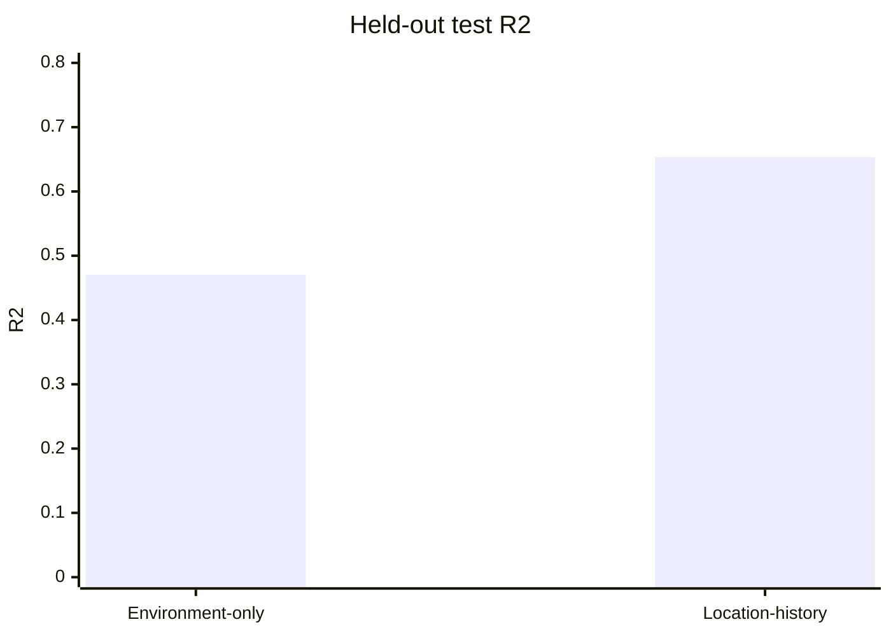

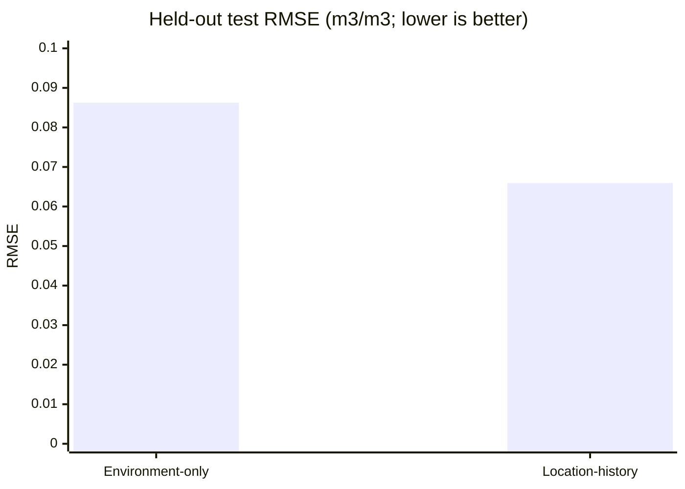

| Metric | Environment-only | Location-history |
|---|---:|---:|
| Test observations | 644,716 | 905,248 |
| Calibrated RMSE | 0.08626 | **0.06594** |
| Calibrated MAE | 0.06794 | **0.04854** |
| Calibrated R2 | 0.47046 | **0.65341** |
| Robust RMSE | 0.08136 | **0.05604** |
| Robust R2 | 0.51276 | **0.74078** |
| Calibration R2 delta | 0.01757 | **0.65159** |
| SMAP-anchor R2 | 0.25487 | 0.05201 |

The large location-history calibration delta is a diagnostic signal: raw output
calibration is essential for that configuration. It is not evidence that the raw
model has the same performance as the reported calibrated model.

> **Technical achievement — evaluation at population scale without hiding the
> hard cases.** The analysis retained raw and calibrated predictions, computed
> robust and anchor comparisons, matched stations between configurations, and
> generated station, network, temporal, moisture-bin, event, spatial, and
> oracle-tail diagnostics. The result is an observational-campaign-style
> evaluation rather than a single benchmark number.

### 12.2 Year-by-year location-history test behaviour

| Year | Rows | R2 | RMSE |
|---:|---:|---:|---:|
| 2023 | 228,330 | 0.73764 | 0.05635 |
| 2024 | 245,634 | 0.72134 | 0.05952 |
| 2025 | 242,319 | 0.56601 | 0.07422 |
| 2026 | 188,965 | 0.57833 | 0.07296 |

The degradation in 2025–2026 is a useful monitoring target. It may reflect
distribution shift, event composition, coverage, station mix, or target/raster
availability; the diagnostic notebook correctly does not claim a causal
explanation without additional investigation.

### 12.3 Paired comparison

The error-analysis export reports 182,528 matched test rows and 201 matched
stations with at least 10 rows:

- location-history wins at 62.62% of matched stations;
- location-history has lower RMSE at 138 stations;
- environment-only has lower RMSE at 63 stations;
- the largest gains occur at selected SNOTEL, Ru_CFR, REMEDHUS, and RSMN stations;
- some SCAN, SNOTEL, Berlin, and USCRN stations favour environment-only inputs.

This is why paired station metrics are more informative than comparing aggregate
test rows alone.

### 12.4 Oracle high-error trimming analysis

The error-analysis notebook includes a deliberately diagnostic analysis sometimes
described as **oracle trimming**. “Oracle” means that the analysis is allowed to
look at the true observed target and therefore knows which predictions were
worst. It ranks test examples by their realised absolute error, removes the
worst examples, and recomputes R2 on the retained examples.

This answers a useful scientific question:

> How much of the apparent error is concentrated in a small set of extreme,
> identifiable failures?

It does **not** answer:

> What score will a deployed system achieve after removing bad predictions?

At inference time the true ISMN target is unavailable, so a deployed model
cannot know which prediction is wrong. The analysis is therefore a sensitivity
curve and an error-concentration diagnostic, not a revised test score,
acceptance criterion, or permission to discard inconvenient observations.

#### 12.4.1 Results

| Model | Retained-set target R2 | Test examples removed | Retained examples |
|---|---:|---:|---:|
| Location-history | 0.70 | 1.30% | 893,480 |
| Location-history | 0.80 | 7.90% | 833,734 |
| Location-history | 0.90 | 24.10% | 687,084 |
| Environment-only | 0.70 | 16.80% | 536,404 |
| Environment-only | 0.80 | 32.30% | 436,473 |
| Environment-only | 0.90 | 54.10% | 295,925 |

The interpretation is relative, not absolute:

- The location-history model reaches R2 = 0.70 after removing only 1.30% of
  its worst test errors, whereas the environment-only model requires 16.80%.
- Reaching R2 = 0.90 requires retaining 75.90% of location-history examples,
  but only 45.90% of environment-only examples.
- This indicates that location history makes the error distribution more
  concentrated and reduces the population of very large misses, although the
  remaining hard cases still matter scientifically.

#### 12.4.2 Why this is useful for physics

A small number of large errors can arise from unusual hydrological events,
sensor outages, depth mismatch, missing satellite observations, or a regime not
represented in training. A trimming curve tells us whether the model is
uniformly mediocre or mostly accurate with a tail of difficult cases. The
separate station, month, moisture-bin, and event-window tables then identify
where that tail lives.

The correct follow-up is to explain or detect the hard cases using information
available before prediction: missingness flags, acquisition offsets, network,
climate regime, target depth, or uncertainty estimates. It is not to use the
observed target to remove failures after the fact.


### 12.5 Included diagnostic graphs

The repository already contains generated figures. The most useful report views
are embedded below:


Additional figures cover Europe, North America, Oceania, South Asia, Africa,
East/Southeast Asia, wet/dry target bins, monthly errors, high-error trimming,
and late-2025 event context. The complete figure/table inventory is recorded in
[`analysis_manifest.json`](./error_analysis_results_v19_5/analysis_manifest.json).

---

## 13. Technical challenges and solutions

The project contains two kinds of difficulty. A **systems hurdle** is a
failure of storage, networking, memory, scheduling, or data association. A
**scientific/ML hurdle** is a failure to preserve the meaning of a measurement,
to separate generalisation from memorisation, or to interpret a statistical
score as a physical result. The following register makes both explicit.

| Domain | Technical hurdle | What can go wrong | Implemented solution or current control | Consequence for a physics interpretation | Evidence / required follow-up |
|---|---|---|---|---|---|
| Data contract | ISMN files use heterogeneous sensors, depths, headers, and quality states | Numerically valid rows from different depths or quality classes are treated as the same physical target | Versioned `global-v2` contract, header audit, explicit 0–5 cm and 5–10 cm classes, `G` filtering, source provenance | The target is a controlled observation class, not an unrestricted “soil moisture” quantity | [`global_data_contract.py`](./global_data_contract.py), [`build_global_ismn_catalog.py`](./build_global_ismn_catalog.py); report depth-stratified metrics should be added |
| Depth pooling | Primary and fallback depths have different response times and storage physics | Error may reflect depth mismatch rather than predictor failure; network composition can dominate the score | Depth class is retained in the catalog and fallback policy is explicit | Headline scores combine physically distinct layers unless stratified | [`build_global_ismn_dataset.py`](./build_global_ismn_dataset.py); report 0–5 cm versus 5–10 cm results separately |
| Temporal target definition | Hourly measurements are reduced to UTC daily means | Event onset, diurnal structure, and observation-count uncertainty disappear into one scalar | Good observations are aggregated by station-file and UTC day while counts and provenance are retained | The task is prediction of a quality-filtered daily aggregate, not instantaneous moisture | [`build_global_ismn_dataset.py`](./build_global_ismn_dataset.py); add event-timing and count-weighted diagnostics |
| Archive scale | Full extraction and dataframe materialisation exceed RAM and temporary disk | The pipeline fails before modelling or spends time repeatedly parsing the same archive | Stream ZIP/directory members, aggregate one station at a time, write Zstandard Parquet | The reduction is computational, but it also defines the temporal statistic being modelled | [`build_global_ismn_dataset.py`](./build_global_ismn_dataset.py) |
| Duplicate labels | Multiple sensors or layers produce several records for one station/date | Joins multiply rows, targets become ambiguous, and metrics overweight duplicate instruments | Preserve raw provenance, define daily aggregation, validate station/date uniqueness in manifests | A station-day represents an explicit aggregation policy rather than an arbitrary last value | [`build_global_label_dates.py`](./build_global_label_dates.py), [`build_global_tensors.py`](./build_global_tensors.py) |
| Remote acquisition timing | Sentinel-1 uses nearest valid acquisition within 18 days; MODIS uses product windows | Predictor and target can represent different hydrological states during rainfall, irrigation, freeze/thaw, or rapid drying | Deterministic nearest-valid selection, earlier-date tie break, acquisition metadata, separate product windows | Dynamic predictors are temporally proximate, not always contemporaneous | [`BUILD_SENTINEL_RTC_GLOBAL_overview_production_v9_vv_vh_only.ipynb`](./BUILD_SENTINEL_RTC_GLOBAL_overview_production_v9_vv_vh_only.ipynb); stratify error by acquisition age |
| Geospatial support | MODIS, Sentinel-1, static layers, and station labels have different grids and footprints | IDs can align while pixel-centre, CRS, affine transform, resampling, or support area differs | Row-order, shape, dtype, sidecar-ID, sampled-read, and completion QA; modality arrays remain separate | Index alignment does not prove that the physical areas averaged by each sensor are identical | [`verify_global_raster_alignment.ipynb`](./verify_global_raster_alignment.ipynb), [`verify_global_raster_row_order.ipynb`](./verify_global_raster_row_order.ipynb); add sampled geolocation/support checks |
| Cloud catalogue scale | One STAC search/COG read per sample repeats fixed remote overhead | Catalogue latency, signing, tile lookup, decompression, and HTTP round trips dominate wall time | Spatial/temporal clustering, cached searches, COG windows, SQLite inventory, Azure Poland client | The speedup comes from request geometry, not from changing the authoritative Planetary Computer data | [`sentinel1-rtc/BUILD_SENTINEL_RTC_GLOBAL_v12_EIGHT_SCENE_WORKERS.ipynb`](./sentinel1-rtc/BUILD_SENTINEL_RTC_GLOBAL_v12_EIGHT_SCENE_WORKERS.ipynb) |
| Raster resolution | Native Sentinel-1 pixels are much finer than the 1 km model target | Exact reads create huge bandwidth and decompression costs | Production uses benchmarked 512 x 512 overviews; exact native path is preserved and namespaced separately | Overview output is an approximation to native-pixel aggregation and must not be interpreted as identical | [`BUILD_SENTINEL_RTC_GLOBAL_overview_production_v9_vv_vh_only.ipynb`](./BUILD_SENTINEL_RTC_GLOBAL_overview_production_v9_vv_vh_only.ipynb); run exact/overview sensitivity |
| Missing observations | Null satellite data are converted to zeros or ignored without telling the model | The network confuses “dry” with “not observed” and learns availability artefacts | Value-plus-validity-mask channels, explicit SMAP availability/count fields, finite-value checks | A mask can be physically useful but can also encode product, region, or season availability | [`prepare_local_normalized_raster_cache.py`](./prepare_local_normalized_raster_cache.py); test mask-only and missingness-stratified baselines |
| Interrupted extraction | A VM/network failure invalidates a multi-day global job | Completed scenes are downloaded again or partial files are mistaken for complete data | Idempotent NPZ shards, completion markers, SQLite state, manifests, checksums, atomic promotion | Integrity metadata protects the scientific dataset from silent partial coverage | [`CREATE_SENTINEL_AZURE_RESUME_BUNDLE.ipynb`](./CREATE_SENTINEL_AZURE_RESUME_BUNDLE.ipynb), [`sentinel1-rtc/RECEIVE_VALIDATE_SENTINEL_AZURE_BUNDLE.ipynb`](./sentinel1-rtc/RECEIVE_VALIDATE_SENTINEL_AZURE_BUNDLE.ipynb) |
| Raster cache correctness | A cache built with different years, scalers, or fill rules is reused | Model sees stale or inconsistently normalised inputs while filenames still look valid | Scaler SHA-256 fingerprints, build signatures, shape/dtype checks, `.building` files, atomic rename | A reproducible checkpoint requires a reproducible preprocessing state | [`prepare_local_normalized_raster_cache.py`](./prepare_local_normalized_raster_cache.py) |
| Training I/O | Per-patch reads have low reuse and repeatedly decode compressed chunks | GPU waits on Python, disk, decompression, or host-to-device copies | Native chunk caching, vectorised gathers, mmap mirrors, bounded workers, pinned memory, asynchronous prefetch | Throughput optimisations do not add physical information; they make the same experiment feasible | [`prepare_local_raster_mmap_cache.py`](./prepare_local_raster_mmap_cache.py), v19.5 training notebook |
| GPU memory | Full effective batch and multimodal activations do not fit in VRAM | Out-of-memory errors or a statistically noisy tiny batch | Microbatches, gradient accumulation, FP16/AMP, channels-last transfer, GPU-fit estimates with headroom | Accumulation approximates a large batch but does not make all batch-dependent operations identical | [`run_global_soil_model_v19_5_persistent_cache_compile_default_reupload.ipynb`](./run_global_soil_model_v19_5_persistent_cache_compile_default_reupload.ipynb), [`check_zarr_gpu_fit.py`](./check_zarr_gpu_fit.py) |
| Numerical precision | FP16 and normalisation reduce storage and transfer volume | Clipping to [-10, 10] and half-precision quantisation can alter tail information | Train-only scalers, explicit clipping, masks, FP16 caches, higher-precision sensitive operations | The deployed representation is clipped FP16 plus availability channels, not the original raster | [`prepare_local_normalized_raster_cache.py`](./prepare_local_normalized_raster_cache.py); compare FP32/no-clipping sensitivity |
| Compilation portability | `torch.compile`, AMP kernels, CUDA versions, and worker scheduling vary by hardware | Same configuration changes runtime, memory use, or small floating-point trajectories | Compilation smoke test with eager fallback; bounded workers; configuration logging | The checkpoint is reproducible only within its recorded software, CUDA, hardware, precision, and compile mode | v19.5 notebook; record environment and measured peak memory |
| Irregular histories | Missing dates and padded history slots are treated as real observations | “Last step” may actually be padding; temporal pooling becomes biased | Explicit masks, last-valid selection, mask-aware pooling, TCN history representation | The temporal branch represents an irregular observation process, not a uniformly sampled sensor | v19.5 model implementation and feature manifests |
| Location memorisation | Coordinates and station history correlate with climate, network, and soil regime | Location-history wins by remembering site/regional identity and fails on novel geography | Network-disjoint split, environment-only comparison, explicit location-risk caveat | Held-out networks are not the same as unseen continents, biomes, or climate regimes | [`build_global_splits.py`](./build_global_splits.py); add leave-region/biome/continent ablations |
| Calibration dominance | Raw location-history RMSE is about 0.11190 while calibrated RMSE is 0.06594 | A quadratic output map can repair scale/curvature and be mistaken for representation skill | Identity-initialised quadratic calibration; raw, calibrated, robust, and anchor metrics are separated | The headline score is a calibrated result and may depend on development-domain statistics | [`error_analysis_results_v19_5/analysis_manifest.json`](./error_analysis_results_v19_5/analysis_manifest.json); fit/freeze calibration only on development data |
| Loss/configuration drift | Historical notebooks mention Huber/weighted Huber while final JSON records MSE | Reimplementation matches a table but not the outlier behaviour of the checkpoint | Treat final exported JSON/configuration as authority and flag v18-era defaults | Robustness claims must name the exact loss, reduction, masking, and target scaling | [`error_analysis_export_v19_5_location_history/model_config.json`](./error_analysis_export_v19_5_location_history/model_config.json), [`PIPELINE_SUMMARY.md`](./PIPELINE_SUMMARY.md) |
| Checkpoint selection | The retained v19.5 workflow selects checkpoints by test R2 | Repeated test evaluation can make the nominal test set part of development | Preserve the fact in the audit trail; interpret the score as development-held-out unless a locked test is rerun | The result is useful, but it is not equivalent to a single untouched final-test estimate | [`run_global_soil_model_v19_5_persistent_cache_compile_default_reupload.ipynb`](./run_global_soil_model_v19_5_persistent_cache_compile_default_reupload.ipynb); rerun with validation-only selection for certification |
| Aggregate weighting | Dense stations and long records contribute more rows | Row-level RMSE can be excellent while sparse stations, regions, or climates are poor | Station/network/month/year tables and paired comparisons; macro-averaging is still needed | The result describes the sampled observation population, not an area-weighted global surface | [`v19_5_full_error_analysis_visualization_v2.ipynb`](./v19_5_full_error_analysis_visualization_v2.ipynb); add confidence intervals and macro scores |
| Statistical dependence | Time-series rows from a station are autocorrelated | Treating hundreds of thousands of rows as independent exaggerates certainty | Report descriptive paired results and stratified diagnostics | Improvement percentages need station/network bootstrap or block uncertainty intervals | [`error_analysis_results_v19_5/tables/paired_metrics.csv`](./error_analysis_results_v19_5/tables/paired_metrics.csv) |
| Physical validation | Finite values and range guards do not enforce hydrological behaviour | Aggregate R2 can coexist with implausible wetting/drying transitions or spatial jumps | Moisture-bin, event-window, seasonal, spatial, and residual diagnostics | Predictive agreement is not conservation, causality, or a water-balance proof | [`error_analysis_results_v19_5/analysis_manifest.json`](./error_analysis_results_v19_5/analysis_manifest.json); add stress tests and event timing |
| Oracle interpretation | Removing worst true errors produces attractive retained-set R2 | The target is unavailable at deployment, so trimming is not an operational filter | Keep oracle curves separate from official metrics and label them diagnostic | It measures error-tail concentration, not achievable deployment performance | [`error_analysis_results_v19_5/plots/high_error_trim_r2_sensitivity.png`](./error_analysis_results_v19_5/plots/high_error_trim_r2_sensitivity.png) |

### 13.1 What the hardest problems actually were

#### 13.1.1 Data association was harder than tensor arithmetic

The most dangerous failure would not necessarily be a Python exception. A
permuted raster row can have the correct shape, finite values, and plausible
statistics while belonging to the wrong station/date. The project therefore
treated sample identity as a first-class data product: station/date keys,
canonical cell IDs, sidecar row indexes, manifests, completion flags, and
sampled value checks were carried through each producer.

For a physics audience, this is analogous to attaching a measurement to the
wrong timestamp or detector channel. The resulting regression can still
converge, but it learns a physically meaningless correspondence. Shape checks
prove only that the arrays fit in memory; identity and geospatial-support checks
are what make the array scientifically interpretable.

#### 13.1.2 “Same date” is not the same as “same physical state”

The in-situ target is a daily aggregate, while remote observations may be
nearest-valid acquisitions or multi-day composites. A station can undergo
rainfall, evaporation, irrigation, freezing, or drainage between the target
measurement and the satellite acquisition. The model can therefore be penalised
for a real temporal mismatch even when every file is correctly aligned.

This is not a bookkeeping detail. Acquisition age should be treated as an
explanatory variable and an uncertainty stratum. A strict same-day analysis
would be more physically synchronous but would reduce coverage; the production
pipeline chose coverage and global scale, so the resulting accuracy includes
temporal representativeness error.

#### 13.1.3 Calibration can repair a numerical map without adding new physics

The raw location-history prediction is poorly scaled, while the calibrated
prediction is strong. The quadratic calibration can correct offset, gain, and
curvature using the anchor and model output. That is valuable for a usable
product, but it changes the interpretation of the score: the result belongs to
the complete predictor-plus-calibrator system.

A physics professor should therefore read the calibrated R2 as agreement after
an empirically learned observation-to-target mapping, not as evidence that the
uncalibrated neural representation alone reproduced the in-situ scale. Raw,
calibrated, and SMAP-anchor metrics are all required to understand this
distinction.

#### 13.1.4 Location is both a useful coordinate and a generalisation risk

Coordinates supply information about broad climate and soil regimes that may
not be fully represented by the measured inputs. They also allow the network to
learn station or region identity. A network-disjoint split prevents the easiest
form of row leakage, but it does not guarantee transfer to a continent, biome,
or climate regime absent from training.

The environment-only comparison is therefore scientifically important. It
separates the value of measured environmental forcing from the extra predictive
power of location/history. The next rigorous test would hold out geographic or
ecological regimes, not merely networks.

#### 13.1.5 Engineering optimisations have scientific boundaries

Overview reads, FP16 caches, clipping, masks, and daily aggregation are not
purely invisible speedups. They define the numerical object seen by the model.
Each was made explicit, versioned, and separated from alternative paths so that
the project could state what was accelerated and what approximation was
introduced.

The correct question is not “did optimisation make it faster?” It is “did the
optimised representation preserve the quantity required by the scientific
question?” Exact-vs-overview comparisons, FP32/no-clipping checks, acquisition
offset strata, and depth-specific results are the appropriate validation
experiments.

### 13.2 What is established versus what remains to be certified

| Status | Established by the current artifacts | Still required for a stronger physics claim |
|---|---|---|
| Data integrity | Contract checks, quality/depth policy, stable IDs, row-order and completion QA | Full modality-by-modality geolocation/support audit |
| Predictive performance | Large held-out row-level metrics, station/network tables, paired comparisons, calibration diagnostics | Block-bootstrap uncertainty, macro-averaged regional scores, locked untouched test |
| Engineering feasibility | Resumable extraction, cache signatures, bounded memory, local mmap/FP16 paths | Hardware-specific peak RSS/VRAM benchmarks for every release |
| ML contribution | Ablation between environment-only and location-history configurations; component descriptions | Controlled modality ablations and geographic novelty holdouts |
| Physical interpretation | Soil/terrain, weather, radar, optical, and anchor pathways are documented | Hydrological stress tests, wetting/drying timing, monotonicity and water-balance diagnostics |
| Error concentration | Oracle trimming, event, seasonal, moisture-bin, station, and spatial tables | Pre-prediction uncertainty or missingness policy that can operate without the true target |

---

## 14. Reproducibility and audit trail

The v19.5 exports record:

- task mode and target mode;
- training cutoff;
- checkpoint source and SHA-256;
- train/test prediction counts;
- manifest configuration and row-group size;
- train-only scaler fingerprints;
- target alignment error checks;
- prediction Parquet paths;
- analysis settings, plots, and CSV tables.

The integrity checks report maximum manifest-target alignment error of approximately
`2.98e-08`, consistent with float32 representation rather than a systematic
join mismatch.

For a reproducible rerun:

1. Freeze the contract and source product versions.
2. Rebuild or verify the ISMN catalog and daily Parquet.
3. Reuse the same label-date/sample-ID rules.
4. Verify all raster stores and row-order contracts.
5. Recreate splits with the recorded seed.
6. Fit scalers only on the training partition.
7. Record the resulting manifest/scaler fingerprints.
8. Run the smoke test before Optuna or full training.
9. Preserve the final checkpoint hash and prediction exports.

---

## 15. Limitations and next steps

### Current limitations

- The global archive is not spatially balanced; dense networks can dominate.
- Surface and fallback-deeper observations are explicitly labelled but are not
  identical physical targets.
- The Sentinel-1 overview path is an efficiency approximation in some products.
- MODIS EVI and LST have different native patch sizes and require careful
  geospatial interpretation.
- Test coverage is network- and availability-dependent, not a uniform global grid.
- Calibration can materially change headline performance and must be reported
  beside raw metrics.
- The current results do not establish equal performance across every climate,
  continent, land-cover class, or soil type.

### Recommended next experiments

1. Add climate-zone, biome, continent, and land-cover holdouts.
2. Report depth-class-specific results and train a depth-aware experiment.
3. Balance or reweight networks and climate regimes.
4. Compare against SMAP, ERA5/GLDAS, XGBoost, and regional CNN baselines
   on the same station-disjoint cohorts.
5. Audit the 2025–2026 performance shift by network, product availability,
   missingness, and event type.
6. Quantify uncertainty with ensembles, conformal intervals, or calibrated
   heteroscedastic heads.
7. Rebuild any artifact whose writer-order provenance cannot be proven from its
   manifest and checksum.
8. Separate a strict 0–5 cm benchmark from the 0–10 cm fallback experiment.
9. Add wall-to-wall global inference only after regional alignment and coverage
   QA pass the same contract used for station evaluation.

---

## 16. Conclusion

The project has evolved from a regional Spain prototype into a reproducible
global data-and-model system. Its strongest engineering contribution is the
separation of concerns: ground-truth auditing, stable sample identity, bounded
remote-sensing exports, explicit raster alignment, leakage-safe cohorts, and
memory-efficient training are treated as first-class components rather than
incidental notebook steps.

The final v19.5 model demonstrates that adding station history and learned
multi-scale multimodal fusion materially improves held-out performance over the
environment-only configuration. The result is most credible when read together
with the paired station diagnostics, calibration analysis, integrity checks, and
the documented limitations above.
